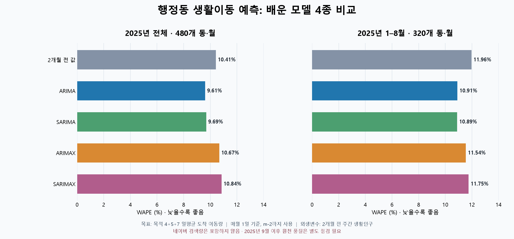

# 중간발표용: ARIMA 계열 4종 적용 결과

작성일: 2026-11-11

> **EDA 후 해석 주의:** 학습 자료의 2024년 8~10월에 40개 동 전반의 큰 급증이 있다. 현재 서울시 배포 원본을 재집계해도 같은 값이 나오지만 원인은 미확인이다. 아래 성능은 잠정 파일럿 수치다. [EDA 재검토](EDA_REVIEW_2026-11-11.md)를 먼저 읽는다.

## 한 장 요약

**연구 질문:** 행정동의 과거 이동량만으로 다음 달 이동량을 예측할 때, 계절성이나 과거 생활인구를 추가하면 성능이 개선되는가?

- **대상:** 서울 행정동 40개, 2023-01~2025-12 월별 자료. 기존 저장소에 집계된 40개 동의 결과이며 서울 전체 427개 동을 대표하는 표본은 아니다.
- **정답값:** 도착 행정동의 목적 4+5+7(쇼핑+관광+기타) 일평균 추정 이동량. 핫플 방문자 수와 같다고 해석하지 않는다.
- **예측 시점:** 매월 1일에 해당 월을 예측한다고 가정. 생활이동과 생활인구는 목표 월의 **두 달 전(m-2)** 값까지 사용한다.
- **학습:** 2023-03~2024-11, 동별 21개월. 모수는 이 구간에서 한 번 추정한 뒤 고정한다. 2025년에는 매월 그때까지 공개 가능하다고 가정한 정답값만 상태에 추가해 2개월 앞을 예측한다.
- **평가:** 2025년 40개 동 × 12개월 = 480행, 네 모형과 단순 기준선을 같은 행에서 비교. WAPE = 절대오차 합 ÷ 실제값 합.

| 방법 | 설정 | 외생변수 | 2025년 MAE | 2025년 WAPE | 1~8월 WAPE |
|---|---|---|---:|---:|---:|
| 두 달 전 값 | `y(m-2)` 반복 | 없음 | 4,557 | 10.41% | 11.96% |
| **ARIMA** | (1,1,0) | 없음 | **4,209** | **9.61%** | 10.91% |
| SARIMA | (1,1,0)×(1,0,0,12) | 없음 | 4,245 | 9.69% | **10.89%** |
| ARIMAX | (1,1,0) | 주간 생활인구 `m-2` | 4,674 | 10.67% | 11.54% |
| SARIMAX | (1,1,0)×(1,0,0,12) | 주간 생활인구 `m-2` | 4,748 | 10.84% | 11.75% |

MAE 단위는 일평균 추정 이동량이다. 모든 동의 목표값과 외생변수에 `log1p` 변환을 적용하고, 예측값을 `expm1`으로 되돌렸다. 모든 모형의 계수는 안정성 조건을 적용했다. 160개 동별 모형 적합이 모두 수렴했으며, 일부 계절형 모형에서 초기 계수에 대한 경고가 발생했다. 이 결과는 **고정한 한 가지 차수의 파일럿 비교**이고, 차수 탐색으로 고른 최적 모형 결과가 아니다.

## 해석

1. 과거 이동량을 이용한 ARIMA가 단순 기준선보다 0.80%p 낮은 WAPE를 보였다. 계절항을 더한 SARIMA와의 차이는 0.08%p로 작다.
2. 생활인구를 추가한 두 모형은 각각 대응하는 단변량 모형보다 오차가 컸다. **현재의 2개월 전 주간 생활인구는 추가 예측력을 보여주지 못했다.** 이는 검색량의 효과를 평가한 결과가 아니다.
   - 동별로는 ARIMAX가 ARIMA보다 19/40개 동, SARIMAX가 SARIMA보다 20/40개 동에서 MAE가 낮았다. 따라서 일부 지역에서는 도움이 될 가능성이 있으나 전체 합산 오차는 커졌다.
3. 동별 시계열이 학습 21개월로 짧아 12개월 계절 패턴을 안정적으로 추정하기 어렵다. 계절형 모형의 성능을 일반적인 우열로 결론내리지 않는다.
4. 2025년 9~12월은 생활이동 원천의 품질 점검 구간이므로 1~8월 수치도 함께 제시했다. 이 구간을 제외해도 네 모형의 순위 차이는 크지 않고, 외생변수 추가에 따른 개선은 확인되지 않았다.
5. 서울시의 목적 분류상 쇼핑·병원은 특정 시설에 한정되어, 4+5 비중이 낮다고 곧바로 여가 유입이 적다는 뜻은 아니다. 반대로 기타(7)의 전부가 여가 방문이라고 증명된 것도 아니다. 현 단계에서는 **비정기 목적 도착 이동량의 대리 지표**로 부른다.

## 발표에서 그대로 쓸 설명

> 월별 생활이동의 도착 행정동 40곳에 대해 ARIMA, SARIMA, ARIMAX, SARIMAX를 같은 조건으로 비교했습니다. 매월 1일에 예측한다고 가정하고 두 달 전까지 확인 가능한 값만 사용했습니다. 2025년 480개 동·월에서 ARIMA의 WAPE가 9.61%로 가장 낮았고, 2개월 전 값을 그대로 쓰는 기준선 10.41%보다 소폭 개선됐습니다. 계절항과 과거 생활인구를 추가해도 뚜렷한 개선은 없었습니다. 아직 네이버 검색량은 이번 이름표 기준으로 수집되지 않았으므로, 검색 변수의 효과는 다음 단계에서 검증하겠습니다.

## 다음 단계와 제한

- 네이버 API 키와 566개 이름표 검색어 묶음의 월별 값이 현재 이 실험에 없다. **ARIMAX/SARIMAX의 X는 네이버 검색량이 아니라 2개월 전 주간 생활인구다.**
- 실제 공개일을 확인해 `m-2` 가정을 다시 점검해야 한다. 2025년 9월 이후 원천 자료도 품질 공지와 대조해야 한다.
- `m-2`부터 2개월 앞을 예측하는 방식은 사용자에게 월초 예측을 설명하기 위한 보수적 설정이다. 예측 시점과 공개 시차가 달라지면 오차도 달라진다.
- 계절성 판단을 강화하려면 더 긴 이력 또는 여러 동을 함께 다루는 접근이 필요하다. 이번 40개 동은 장소 경계 파일럿에서 나온 편의 표본이다.
- 생활인구와 생활이동은 모두 통신 기반 추정 자료라 관련성이 있을 수 있다. 이번 외생변수는 시차를 줬지만 독립적인 외부 관측이라고 해석하지 않는다.

## 재현 파일

- `compare_arima_family.py`: 모델 설정, 시차, 학습·예측 절차.
- `arima_family_predictions_2025.csv`: 4모형 × 40동 × 12개월 = 1,920개 예측행.
- `arima_family_fit_audit.csv`: 동·모형별 수렴, 최적화, 경고 기록.
- `arima_family_summary.json`: 평가 수치.
- `arima_family_wape.png`: 발표용 비교 그래프.

실행: Python 3.12 환경에 `pandas`, `numpy`, `statsmodels`, `matplotlib`을 설치하고 `python compare_arima_family.py --repo <저장소 경로> --out <출력 폴더>`.
