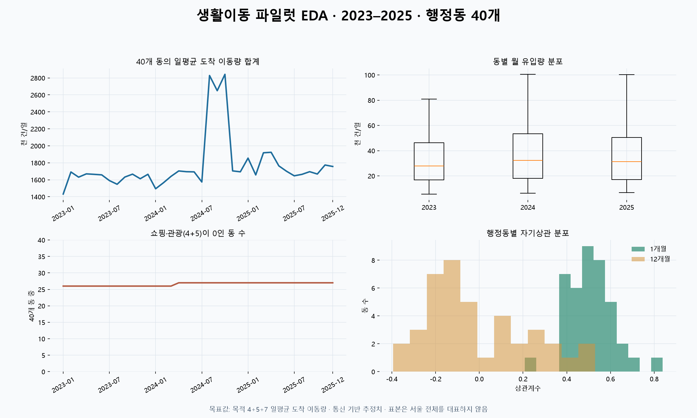
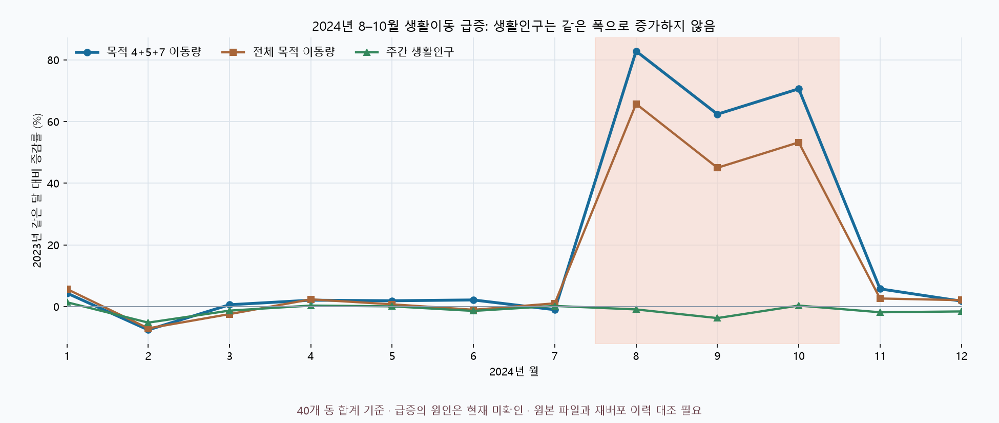

# 생활이동 × 행정동 이름표 EDA 재검토

작성일: 2026-11-11 · 분석 대상: 저장소의 기존 월별 요약과 사용자 제공 `이름표_행정동.zip`

## 가장 중요한 발견

**2024년 8~10월의 광범위한 이동량 급증은 현재 서울시 다운로드 원본에도 있다. 그러나 원인은 확인되지 않아 연간 증가율, 계절성, 모델 성능을 확정 결과로 발표하면 안 된다.** 2024년 8월의 목적 4+5+7 합계는 2023년 8월보다 82.8% 높고, 40개 중 33개 동이 전년 같은 달보다 50% 이상 높다. 9월과 10월 합계도 각각 62.4%, 70.6% 높다. 11월에는 다시 평소 수준으로 내려간다. 같은 2024년 8~10월의 주간 생활인구 합계는 전년 대비 각각 −0.9%, −3.7%, +0.3%다. 생활이동 전체 목적에서도 같은 방향의 급증이 보이며, 월별 행 수는 평소와 비슷하다.

이 세 달은 결론을 뒤집을 정도로 영향력이 크다.

| 40개 동 합계 기준 | 2024년 / 2023년 | 2025년 / 2024년 |
|---|---:|---:|
| 12개월 전체 | +18.6% | −8.9% |
| 8~10월 제외한 9개월 | +1.0% | +8.4% |

8~10월만 비교하면 2024년은 2023년보다 +71.7%, 2025년은 2023년보다 +3.7%다. 따라서 2025년의 큰 전년 대비 하락을 수요 붕괴로 읽는 것은 부적절하다. 현재 파일의 2024년 세 달이 실제 현상인지, 원천 데이터의 산출·분류 방식 차이인지 확인해야 한다.

### 공식 다운로드 원본 재집계

2026-11-11에 서울시 `OA-22298`의 현재 월별 ZIP 5개(2024년 7~11월)를 다시 받아 같은 40개 행정동의 목적 코드 1~7을 합산했다. 4+5+7 합계는 저장소 요약값과 반올림 오차 이내로 일치했다. 즉, **오래된 요약 CSV만의 급증은 아니다.** 다운로드 파일의 SHA-256과 목적별 합계는 `eda_2024_purpose_verification.json`에 기록했다.

| 월 | 기타(7) 일평균 | 전체 목적 일평균 | 비고 |
|---|---:|---:|---|
| 2024-07 | 153.8만 | 283.2만 | 급증 전 |
| 2024-08 | 276.4만 | 457.2만 | 기타가 전월보다 +79.7% |
| 2024-09 | 259.9만 | 411.6만 | 높은 수준 지속 |
| 2024-10 | 278.5만 | 438.7만 | 높은 수준 지속 |
| 2024-11 | 166.5만 | 297.3만 | 평소 수준 복귀 |

## 자료의 기본 상태

| 검사 | 결과 |
|---|---:|
| 기간 | 2023-01~2025-12, 36개월 |
| 행정동 | 40개 (서울 전체 427개 중 일부) |
| 동·월 행 | 1,440개 |
| 누락된 동·월 / 중복 | 0 / 0 |
| 생활인구 결측 / 이름표 코드 불일치 | 0 / 0 |
| 월별 관측일 | 28~31일 |
| 음수 또는 전체 목적 유입량을 넘는 목표값 | 0 |

입력은 저장소 `data/context_monthly/mobility_*.csv`, `living_*.csv`의 **기존 집계 파일**이다. 이번 EDA는 원본 ZIP의 목적별 행을 재집계하지 않았다. 따라서 위의 무결성은 월별 요약 파일 내부에 대한 검사다. 40개 동은 기존 장소 파일럿에서 고른 편의 표본이므로 서울 전체의 추세로 일반화하지 않는다.

## 목표값의 구성과 규모

- 목적 4+5+7의 동·월별 일평균 추정 이동량 중앙값은 **30,711**, 25~75백분위는 **17,423~49,084**다. 최소 5,610, 최대 306,413으로 규모 차이가 크다.
- 목표값은 같은 행의 전체 목적 이동량 합계 중 **58.2%**다. 그 목표값 중 쇼핑·관광 4+5는 전체 기간 합계에서 **2.28%**이고, 기타 7은 97.72%다.
- 4+5가 0인 동·월은 **957/1,440(66.5%)**, 36개월 내내 0인 동은 **26/40**이다. 4+5를 단독 정답값으로 쓰기 어려운 이유다. 4+5 비중이 낮다는 사실이 일반적 여가 방문의 부재를 뜻하지는 않는다. 서울시는 쇼핑을 백화점·아울렛 등 일부 시설에 한정해 분류한다. [서울시 생활이동 FAQ](https://data.seoul.go.kr/dataVisual/seoul/capitalRegionLivingMigration.do)
- 평균 유입량 상위 5개 동(여의동, 종로1·2·3·4가동, 역삼1동, 서교동, 잠실6동)이 40개 동 합계의 **39.4%**를 차지한다. WAPE는 이처럼 규모가 큰 동의 오차에 더 민감하므로 동별 MAE나 동별 WAPE도 함께 봐야 한다.

## 계절성과 외생변수

- 동별 1개월 자기상관의 중앙값은 **0.50**이다. 직전 관측치가 예측에 유용한 출발점이라는 관찰과 맞는다.
- 12개월 자기상관 중앙값은 전체 자료에서 **−0.10**이지만, 2024년 8~10월을 포함하는 연도 간 비교쌍만 빼면 **+0.54**다. 이는 계절성이 없다는 근거가 아니라, 세 달의 급증이 계절성 지표를 크게 흔든다는 뜻이다. 비교쌍을 제외한 계산은 진단용이며 결측을 임의로 채워 모델을 다시 학습한 결과가 아니다.
- 생활인구와 목표값의 단순 합동 수준 상관은 **0.91**이지만, 동별 월별 로그 변화 간 상관은 **0.38**이다. 큰 동이 두 값 모두 큰 공간적 규모 효과가 수준 상관에 들어가 있다. 높은 수준 상관만으로 생활인구가 미래 유입을 예측한다고 주장할 수 없다.
- 이름표의 동네·역 칸은 파일럿 40개 동 모두에 있고 권역 칸은 20개 동에 있다. 이름표는 공간 연결표이며 네이버 월별 검색값이 아니다.

## 모델 결과에 미치는 영향

기존 [ARIMA 계열 비교](ARIMA_FAMILY_PRESENTATION.md)의 학습 구간에는 2024년 8~10월이 들어 있다. 네 모형 비교 자체는 같은 자료·같은 평가 행에서 이루어졌지만, **그 자료의 급증 원인이 불명확하여 성능의 일반화는 잠정적**이다. “ARIMA가 최종적으로 가장 좋은 모델”이라고 발표하기보다 “현재 배포 자료의 40개 동 파일럿에서 ARIMA가 단순 기준선보다 소폭 낮은 오차를 보였다”라고 표현한다.

별개로 서울시는 **2025년 9월부터 원천데이터 단계의 차이를 확인해 품질을 점검한다**고 공지했다. 그래서 2025년 전체와 1~8월 평가를 나란히 제시한 방식은 유지한다. [서울시 품질 점검 공지](https://data.seoul.go.kr/together/notice/datasetNoticeView.do?bbsCd=10008&ditcCd=&pageIndex=1&seq=8e761caf2ef8f864e8b79951c3fa74c2)

## 우선 확인할 일

1. 공식 배포 파일의 2024년 8~10월 급증 원인을 서울시 자료 설명·문의 또는 독립적인 유동 자료와 대조해 확인한다. 현재 다운로드 원본과 저장소 요약은 일치한다. 원인이 확인되기 전에는 해당 달을 삭제하거나 임의 보정하지 않는다.
2. 목적별 산출·전수화 방식의 시점별 변경이 있었는지 확인한다. 기타(7)뿐 아니라 전체 목적도 같이 증가한 이유가 핵심이다.
3. 2025년 9월 이후 자료의 최신 재배포 여부와 품질 공지 상태를 확인한다.
4. 이상 구간 처리 규칙을 정한 뒤 ARIMA 계열 비교를 다시 수행한다. 40개 동 표본의 선정 이유와 427개 동 확장 계획을 발표에 명시한다.

## 재현 파일

`run_eda.py`가 `eda_summary.json`, `eda_monthly.csv`, `eda_dong_summary.csv`, `eda_autocorrelation.csv`, `eda_overview.png`, `eda_2024_anomaly.png`를 만든다. `verify_2024_purposes.py`는 현재 공식 월별 ZIP을 다시 받아 `eda_2024_purpose_verification.json`을 만든다. Python 3.12에 `pandas`, `numpy`, `matplotlib`을 설치한 뒤 다음처럼 실행한다.

`python run_eda.py --repo <저장소 경로> --nameplate <사용자 ZIP 경로> --out <출력 폴더>`
