# 서울 행정동 검색량·음식점 개폐업 시계열 예측 결과 리포트

> Team #14 HEAT · F&B·검색 파트 · 2026-11-12
> 계획: `docs/forecast_plan.md` (v3) · 코드: `src/forecast/` · 자세한 표: `06_tables.md`, 데이터 점검: `01_checks.md`
> 이 리포트의 예측 성능은 **개발 fold(F2024, F2025) 결과**다. 최종 시험(2026-01~09)은 아직 실행하지 않았다.

---

## 0. 요약

1. **개폐업은 3개월 앞 예측에서 기준선을 넘는다.** 동 단위 개업·폐업·순증률 모두 가장 좋은 모델(ETS, LightGBM, Ridge)이 계절 naive보다 오차가 15~20% 작다(두 fold 모두, DM 검정 p < 0.05). 다만 모델끼리의 차이는 작아 단순한 모델(ETS, Ridge)로 충분하다.
2. **검색 비중은 2024년만 맞혔다.** 2024년에는 LightGBM이 계절 naive보다 오차를 약 25% 줄였지만, 2025년에는 어떤 모델도 기준선과 차이가 없었다. 2025년에 동별 검색 비중의 월 변동이 두 배로 커졌기 때문이다.
3. **예측력은 3개월을 넘으면 빠르게 사라진다.** 12개월 앞 동별 개업 수는 "최근 12개월 그대로"보다 잘 맞힌 모델이 없다.
4. **검색과 개폐업은 3개월 예측에서 서로 돕지 않는다.** 서로의 값을 피처로 넣어도 성능이 거의 같거나 조금 나빠진다.
5. **"큰 곳"은 해마다 같고, "크는 곳"은 해마다 바뀐다.** 동별 검색 비중·개업 수 순위는 해마다 거의 그대로(순위상관 0.91~0.998)지만, 순증률 순위는 거의 섞인다(0.11~0.19). 검색 비중 변화는 오히려 되돌아간다.
6. **서울 음식점 시장은 2024년부터 줄고 있다.** 폐업이 매년 늘어 2024년에 개업을 따라잡았고, 영업 점포는 2023년 말 최고점에서 2년 동안 3.9% 줄었다.
7. **지금의 핫스팟**: 검색은 성수·용산·잠실, 개업은 삼성1동(코엑스)·여의도·영등포·한강로동. **떠오르는 곳**: 검색은 광진구 군자역~아차산 일대, 점포는 중구 을지로동.

---

## 1. 데이터와 방법

### 1.1 데이터

| 데이터 | 내용 | 기간 |
|---|---|---|
| 네이버 검색량 | 이름표 검색어 묶음 × 방문 의도어 6개. 동별 지수를 **서울 합계 대비 비중**으로 바꿔 쓴다 | 2022-01 ~ 2026-10 |
| 음식점 인허가 | 일반·휴게음식점 합침. 편의점·구내매장 등 제외 업종 빼고, 좌표로 행정동에 붙임 | 2015-01 ~ 2026-10 |

- 검색 비중이 있는 동 422개, 음식점 동 427개.
- 포함 업종 점포 664,496개 중 **622,857개(93.7%)**를 행정동에 붙였다. 2018년 이후 개업 점포 중 못 붙인 비율은 연 0.4~1.7%로 낮고 해마다 비슷하다.

### 1.2 예측 대상

| 대상 | 정의 | 수준 |
|---|---|---|
| 검색 비중 | t+1 ~ t+h 평균 서울 대비 비중 | 동 |
| 개업 수 | t+1 ~ t+h 합 | 서울·구·동 |
| 폐업 수 | t+1 ~ t+h 합 (일괄 폐업 제외 `v_drop` 기본, 포함 `v_keep` 함께) | 서울·구·동 |
| 순증률 | Σ(개업 − 폐업) / t월 영업 점포 수 | 서울·구·동 |

### 1.3 검증 구조

| fold | 학습 | 시험 연도 | origin 수 (h = 3 / 6 / 12) |
|---|---|---|---|
| F2024 | 2022-01 ~ 2023-12 | 2024 | 10 / 7 / 1 |
| F2025 | 2022-01 ~ 2024-12 | 2025 | 10 / 7 / 1 |

- origin t마다 t월 말까지의 자료로만 예측한다. 검색 계절 계수는 fold 학습 구간으로 다시 계산했다.
- 예측 거리: 3개월 기본, 6·12개월 보조.

### 1.4 모델

| 종류 | 모델 | 적용 |
|---|---|---|
| 기준선 | Naive (최근 h개월 그대로), Seasonal Naive (1년 전 같은 h개월) | 전부 |
| 국소 | ETS, Theta | 전부 |
| 국소 | SARIMA (AutoARIMA) | 검색 모든 동, 개폐업 서울·구·개폐업 많은 동 84개 |
| 국소 | Croston, TSB | 개업·폐업이 0인 달이 30% 이상인 동 100~102개 |
| 국소 + 외생 | SARIMAX (코로나 더미 + 다른 데이터의 시차 h 값) | SARIMA와 같은 범위, h = 3·6 |
| 전역 | LightGBM (개수는 Poisson), Ridge (같은 피처) | 동 전체. 구·서울은 동 예측의 합 |

- 전역 모델은 피처 묶음 두 가지로 돌렸다. `base`(자기 시차 + F&B 지표 + 달력)와 `+x`(검색 모델에 개폐업, 개폐업 모델에 검색 추가).
- 순증률은 개업·폐업 예측에서 계산한 값과, 전역 모델로 바로 예측한 값(`·직접`)을 모두 봤다.

### 1.5 평가 지표

- **MASE**: 모델 오차 ÷ 학습 구간 계절 naive 오차. **1보다 작으면 계절 naive보다 낫다.** 시험 연도가 학습 구간보다 많이 흔들리면 계절 naive 자신도 1을 넘는다.
- **DM-HLN 검정**: 두 모델의 origin별 오차 차이가 우연인지 본다.
- **top-K 적중률**: 예측 상위 K개 동 중 실제 상위 K개에 든 비율.
- Poisson deviance(개수 대상)는 `06_metrics.csv`에 있다.

---

## 2. 데이터 점검

| 항목 | 결과 | 처리 |
|---|---|---|
| 매핑표에 없는 업태 | 16개 업태, 53개 점포 (결측 18, 푸드트럭 15 등) | 제외, `reports/unmapped_categories.csv` |
| 일괄 폐업 | 599건, 11,306개 점포. **2024년부터 두 배 이상 증가**(전체 폐업의 4% → 9~10%) | 플래그, `v_drop` 기본 |
| 일괄 폐업이 몰리는 달 | 4월 17%, 12월 14%, 6월 11% | 폐업 계절 모양을 바꿈 |
| 폐업 신고 지연 | 폐업 기록의 99%가 폐업일 30일 안에 기록됨 | 영향 작음 |
| 0이 많은 동 | 개업 또는 폐업이 0인 달 30% 이상: 102개 동 | Croston/TSB 적용 |

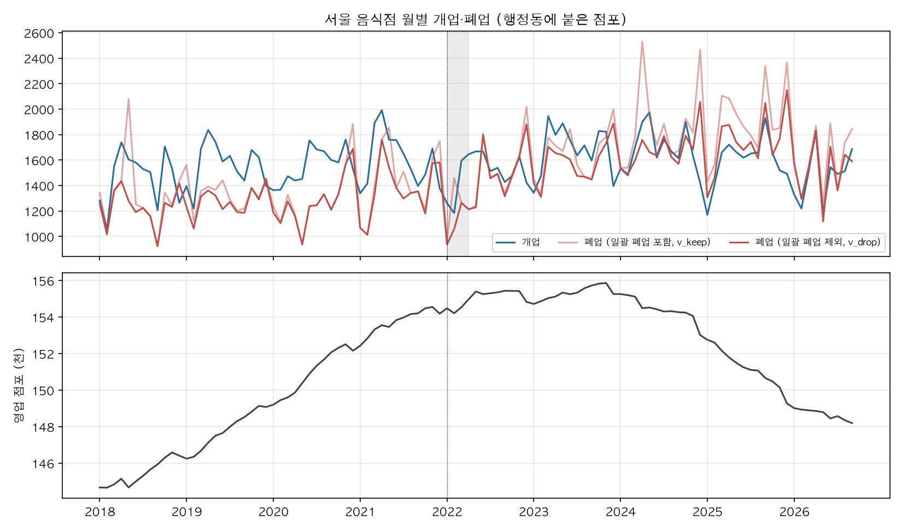

---

## 3. 예측 결과

### 3.1 3개월 앞, 동 단위 (주 결과)

MASE (1보다 작으면 계절 naive보다 나음)

| 대상 | 가장 좋은 모델 | F2024 | F2025 | 계절 naive (F2024 / F2025) | 계절 naive와 차이 |
|---|---|---:|---:|---|---|
| 개업 수 | ETS | 0.95 | 0.99 | 1.12 / 1.22 | 두 fold 모두 유의 (p ≤ 0.01) |
| 폐업 수 | LightGBM | 0.94 | 0.99 | 1.14 / 1.23 | 두 fold 모두 유의 (p < 0.001) |
| 순증률 | Ridge | 0.92 | 1.02 | 1.14 / 1.26 | 두 fold 모두 유의 (p < 0.001) |
| 검색 비중 | LightGBM | 0.97 | 2.25 | 1.26 / 2.20 | **F2024만 유의**, F2025 p = 0.86 |

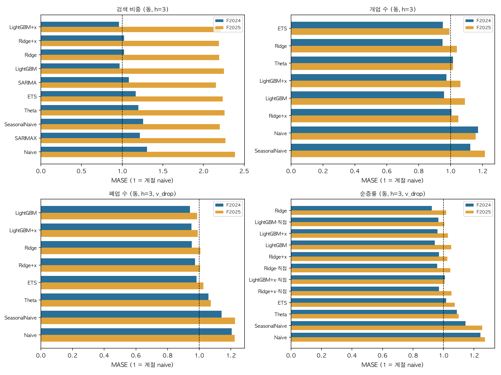

모델별 세부 (개업 수)

| 모델 | F2024 | F2025 |
|---|---:|---:|
| ETS | 0.95 | 0.99 |
| Ridge | 0.95 | 1.04 |
| LightGBM | 0.96 | 1.09 |
| Theta | 1.02 | 1.02 |
| Naive | 1.17 | 1.16 |
| Seasonal Naive | 1.12 | 1.22 |

- 개업·폐업·순증률 모두 **기준선은 확실히 넘지만 모델 간 차이는 작다.** 계획(§5)에 따라 LightGBM과 비슷하면 단순한 Ridge·ETS를 주 모델로 보고한다.
- 동별 개업 3개월 합의 평균 오차는 약 3.5~3.8건이다. 동 하나의 3개월 개업이 보통 6~12건이라 오차가 작지 않다.
- 개폐업 많은 동(84개)에서 SARIMA는 개업 0.98 / 1.05로 ETS와 비슷하다. 0이 많은 동(100여 개)에서는 ETS(0.98 / 1.00)가 Croston·TSB보다 낫다.

### 3.2 예측 거리별

가장 좋은 모델의 MASE (F2024 / F2025)

| 대상 | h = 3 | h = 6 | h = 12 |
|---|---|---|---|
| 개업 수 | 0.95 / 0.99 | 1.16 / 1.16 (ETS) | **1.73 / 1.57 = Naive와 같음** |
| 폐업 수 | 0.94 / 0.99 | 1.08 / 1.16 | 1.69 / 1.50 (Naive 1.81 / 1.62) |
| 순증률 | 0.92 / 1.01 | 1.13 / 1.23 | 1.97 / 1.62 (Naive 2.00 / 1.73) |
| 검색 비중 | 0.96 / 2.15 | 1.43 / 2.25 | 판단 불가 |

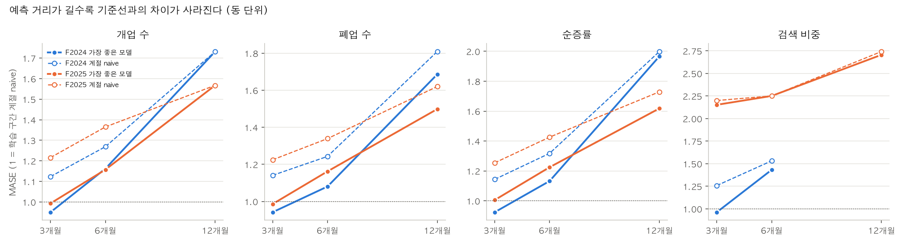

- 6개월부터는 기준선과의 차이가 줄고, 12개월에서는 거의 없다.
- h = 12는 fold마다 origin이 1개뿐이라 검정할 수 없다. 검색 h = 12 F2024의 MASE(15)는 분모가 origin 1개로 계산된 탓이라 해석하지 않는다.

### 3.3 집계 수준별 (개업 수, h = 3)

| 수준 | 가장 좋은 모델 (F2024 / F2025) | 계절 naive |
|---|---|---|
| 서울 | **계절 naive** 0.13 / 0.89 | 0.13 / 0.89 |
| 구 (25) | LightGBM 0.90 / Ridge 1.03 | 1.05 / 1.08 |
| 동 (427) | Ridge 0.95 / ETS 0.99 | 1.12 / 1.22 |

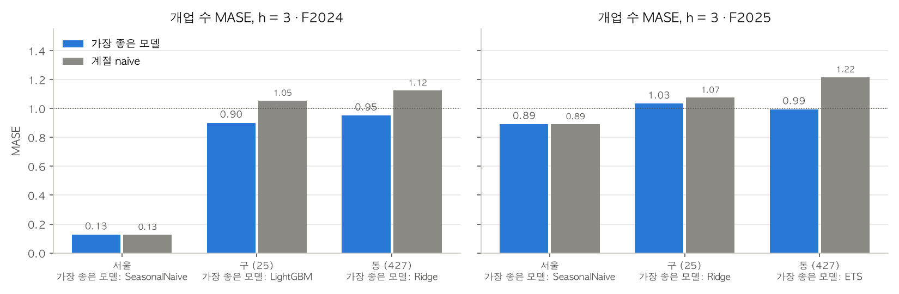

- 서울 전체는 계절 naive가 가장 좋다. 집계할수록 잡음이 줄고 계절 패턴이 드러나기 때문이다.
- 폐업은 서울 수준에서도 Theta·SARIMAX(0.31 / 0.44)가 계절 naive(0.51 / 0.56)보다 낫다.

### 3.4 일괄 폐업을 넣으면

| 폐업 수 (동, h = 3) | 계절 naive | LightGBM | Ridge |
|---|---:|---:|---:|
| 일괄 폐업 제외 (`v_drop`) | 1.14 / 1.23 | 0.94 / 0.99 | 0.95 / 1.01 |
| 일괄 폐업 포함 (`v_keep`) | 1.34 / 1.35 | 1.14 / 1.10 | 1.15 / 1.09 |

일괄 폐업을 넣으면 모든 모델의 오차가 15~20% 커진다. 일괄 폐업은 예측할 수 없는 행정 충격이므로 빼고 모델링하는 것이 맞다.

### 3.5 검색 ↔ 개폐업 교차 피처

같은 모델에서 교차 피처만 넣고 뺀 비교 (h = 3, 동, 양수 = 넣으면 나빠짐)

| 대상 | 모델 | F2024 | F2025 |
|---|---|---|---|
| 개업 | LightGBM | 나빠짐 (p < 0.001) | 좋아짐 (p = 0.01) |
| 개업 | Ridge | 나빠짐 (p < 0.001) | 나빠짐 (p = 0.003) |
| 폐업 | LightGBM | 나빠짐 (p = 0.04) | 차이 없음 (p = 0.10) |
| 순증률 | Ridge | 나빠짐 (p < 0.001) | 나빠짐 (p = 0.03) |
| 검색 | LightGBM · Ridge | 차이 없음 (p > 0.25) | 차이 없음 (p > 0.25) |

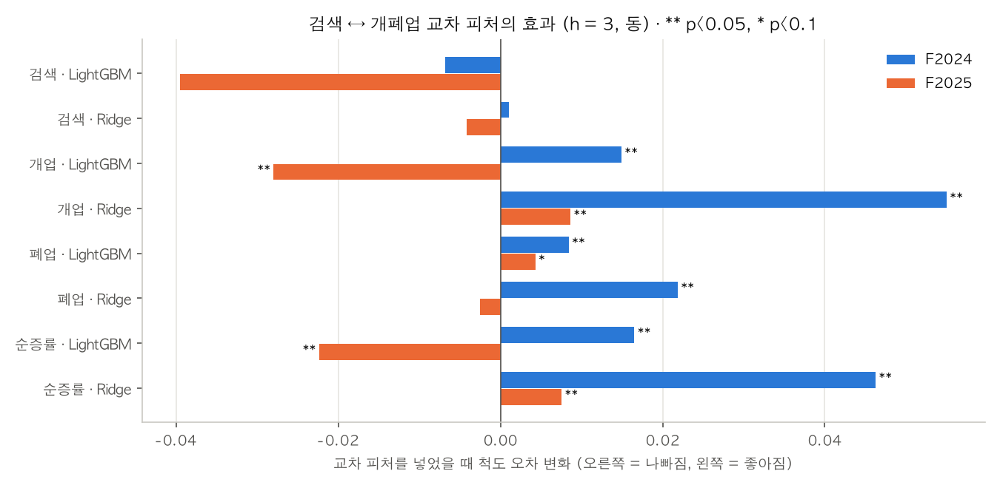

- 교차 피처의 LightGBM 중요도 비중은 0.4~5%에 그친다.
- **3개월 앞 예측에서는 서로 정보를 더하지 못한다.** 이것이 "관계가 없다"는 뜻은 아니다. 같은 달에 함께 움직이거나 시차가 3개월보다 길 수 있다. 선후 관계는 v2 계획의 선후 관계 분석(국소 투영, 사전백색화 교차상관)으로 따로 확인해야 한다.

### 3.6 동 순위 맞히기 (top-20 적중률, h = 3)

| 순위 대상 | 가장 좋은 모델 | F2024 | F2025 | 무작위 |
|---|---|---:|---:|---:|
| 검색 비중 변화 | LightGBM | 0.42 | 0.30 | 0.06 |
| 개업 수 | Theta, LightGBM | 0.81 | 0.78 | 0.05 |
| 순증률 | ETS, Theta | 0.18 | 0.20 | 0.05 |

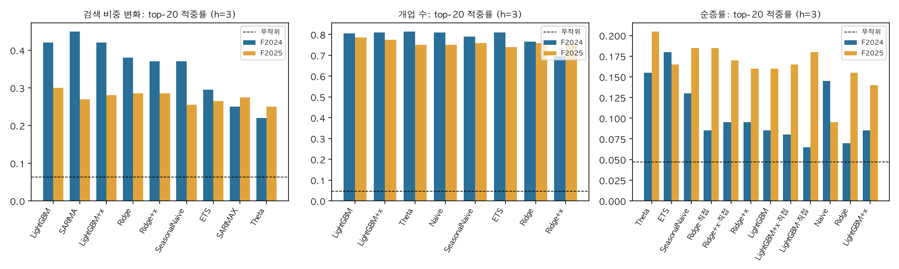

- 개업 수 순위가 높게 맞는 것은 "큰 동이 계속 크기" 때문이다. Naive도 0.75~0.81이라 모델의 공이 아니다.
- **검색 비중이 오를 동은 무작위보다 5~7배 잘 맞힌다.** 이것이 "떠오르는 곳" 예측에 가장 쓸 만한 신호다.
- 순증률 상위 동은 거의 맞히지 못한다.

---

## 4. 시계열 관점의 인사이트

### ① 2024년부터 서울 음식점 시장이 줄어드는 국면이다

| 연도 | 개업 | 폐업 (일괄 제외) | 연말 영업 점포 |
|---|---:|---:|---:|
| 2022 | 18,026 | 16,734 | — |
| 2023 | 20,201 | 18,969 | 155,259 (최고) |
| 2024 | 20,204 | 20,190 | 153,011 |
| 2025 | 19,147 | 20,888 | 149,269 |

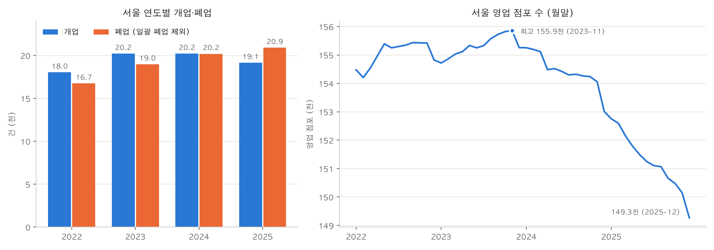

개업은 연 2만 건 안팎으로 평평한데 폐업이 계속 늘었다. 추세가 꺾였기 때문에 2022~2024년으로 학습한 모델이 2025년을 더 어려워한다.

### ② 계절성은 서울에서는 강하고 동에서는 잡음에 묻힌다

서울 전체 달별 계수 (1 = 연평균, 2022~2025)

| | 1월 | 2월 | 3~5월 | 9월 | 10~11월 | 12월 |
|---|---:|---:|---:|---:|---:|---:|
| 개업 | 0.83 | 0.89 | 1.08~1.11 | 0.95 | 1.04~1.06 | 0.87 |
| 폐업 | 0.88 | 0.87 | 1.01~1.07 | 0.92 | 1.02~1.04 | **1.20** |

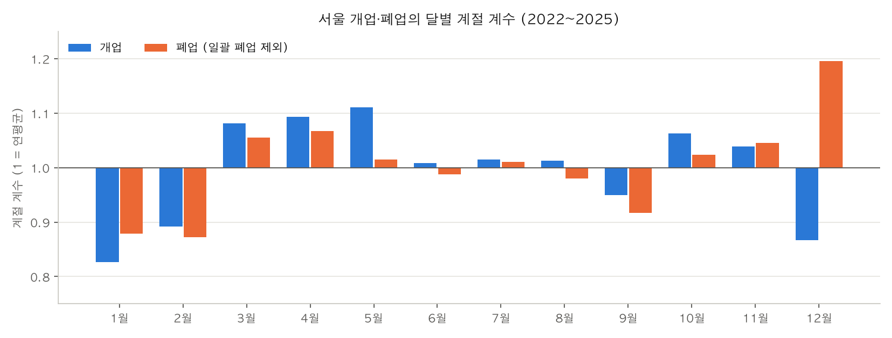

- 봄·가을에 개업이 많고, 폐업은 12월에 몰린다.
- 동 하나의 한 달 개업은 중앙값 2건이라 계절 패턴보다 우연한 변동이 크다. 그래서 동 수준에서는 계절 naive가 지고, 동별 평균 수준을 평활하는 모델이 이긴다.
- LightGBM 개업·폐업 모델(기본 피처 묶음) 중요도의 약 70%가 "동의 학습 구간 평균", 그다음 14~15%가 "12개월 이동평균"이다. **동 단위 개폐업은 "천천히 움직이는 동별 수준 + 큰 잡음"에 가깝다.**

### ③ 크기는 지속되고, 변화는 지속되지 않는다

| 해마다 동 순위가 유지되는 정도 (순위상관) | 2022→23 | 2023→24 | 2024→25 |
|---|---:|---:|---:|
| 검색 비중 | 0.997 | 0.998 | 0.994 |
| 개업 수 | 0.93 | 0.93 | 0.91 |
| **순증률** | **0.11** | **0.19** | **0.12** |

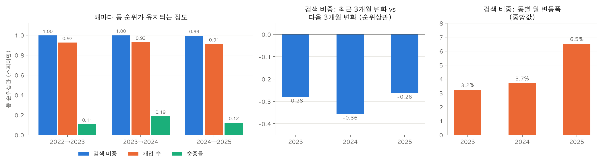

"올해 많이 늘어난 동이 내년에도 늘어난다"는 경향이 약하다. 개폐업 흐름만으로 떠오르는 동을 미리 잡기 어렵다.

### ④ 검색 비중은 되돌아가고, 2025년에 변동이 두 배가 됐다

- 최근 3개월 비중 변화와 다음 3개월 변화의 순위상관: 2023년 −0.28, 2024년 −0.36, 2025년 −0.26. **오른 동은 다음에 내려가는 경향**(평균 회귀)이 있다.
- 동별 월 변동폭 중앙값: 2023년 3.2%, 2024년 3.7%, **2025년 6.5%**.
- 서울 전체 검색 지수 연평균: 2022년 27,151 → 2025년 23,457 (−14%). 그래서 비교는 서울 대비 비중으로 한다.
- 2024년 예측의 개선은 대부분 **동별 계절 패턴** 덕이었다. LightGBM 검색 모델 중요도의 90%가 "앞으로 3개월 계절 계수 ÷ 최근 3개월 계절 계수"다. 2025년에는 그 패턴이 흔들려 효과가 사라졌다.

### ⑤ 순증률은 동의 구조적 특성과 관련된다

순증률 모델에서 동 평균 수준(29%) 다음으로 중요한 피처:
- 영업 점포 평균 업력 (15%)
- 지난 12개월 순증률 (10%)
- 카페 비중 (7%)
- 트렌드 업종 비중의 1년 변화 (5%)

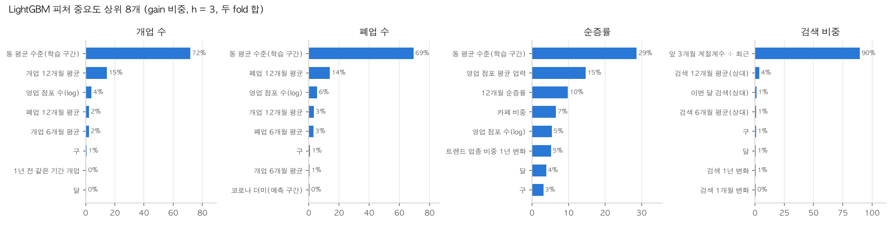

단기 흐름보다 "오래된 가게가 많은 동인지, 트렌드 업종이 느는 동인지" 같은 구조가 순증을 가른다. 방향(늘리는지 줄이는지)은 Ridge 계수나 SHAP으로 확인해야 한다.

---

## 5. 현재 핫스팟과 떠오르는 곳

기술 통계이며, 모델 선택에는 쓰지 않았다. 검색은 2026-10까지, 개폐업은 2026-09까지의 자료다(2026-10 개폐업은 부분 월이라 제외).

| | 현재 핫스팟 | 떠오르는 곳 |
|---|---|---|
| 검색 | 최근 3개월(2026-08~10) 평균 서울 대비 비중 | 1년 전 같은 3개월보다 비중이 늘어난 정도 |
| 개폐업 | 최근 12개월(2025-10~2026-09) 개업 수 | 영업 점포 증가율 (2025-09 → 2026-09) |

떠오르는 곳은 수준 하위 25% 동을 뺐다(작은 동은 증가율이 쉽게 튐). 1년 전과 비교해 계절 영향과 단기 되돌림을 피했다.

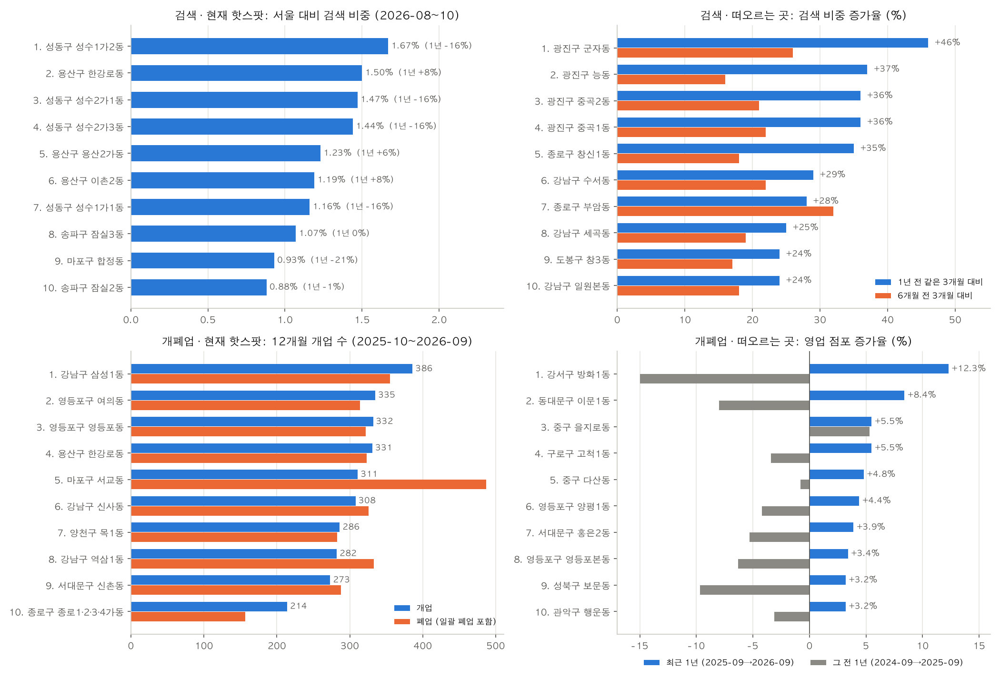

### 5.1 검색 기반 현재 핫스팟

| # | 동 | 서울 대비 비중 | 1년 전보다 |
|---|---|---:|---:|
| 1 | 성동구 성수1가2동 | 1.67% | −16% |
| 2 | 용산구 한강로동 | 1.50% | +8% |
| 3 | 성동구 성수2가1동 | 1.47% | −16% |
| 4 | 성동구 성수2가3동 | 1.44% | −16% |
| 5 | 용산구 용산2가동 | 1.23% | +6% |
| 6 | 용산구 이촌2동 | 1.19% | +8% |
| 7 | 성동구 성수1가1동 | 1.16% | −16% |
| 8 | 송파구 잠실3동 | 1.07% | 0% |
| 9 | 마포구 합정동 | 0.93% | −21% |
| 10 | 송파구 잠실2동 | 0.88% | −1% |

- **성수**는 여전히 최상위지만 1년 새 비중이 16% 줄었다. 정점을 지나 자리 잡은 핫스팟이다.
- **용산(한강로·용산2가·이촌2)**은 수준도 높고 아직 늘고 있다. 지금 가장 강한 곳이다.
- **합정**은 −21%로 가장 많이 줄었다.

### 5.2 검색 기반 떠오르는 곳

| # | 동 | 1년 전보다 | 6개월 전보다 | 비중 순위 (422개 중) |
|---|---|---:|---:|---:|
| 1 | 광진구 군자동 | +46% | +26% | 26 |
| 2 | 광진구 능동 | +37% | +16% | 66 |
| 3 | 광진구 중곡2동 | +36% | +21% | 109 |
| 4 | 광진구 중곡1동 | +36% | +22% | 111 |
| 5 | 종로구 창신1동 (동묘) | +35% | +18% | 197 |
| 6 | 강남구 수서동 | +29% | +22% | 49 |
| 7 | 종로구 부암동 | +28% | +32% | 137 |
| 8 | 강남구 세곡동 | +25% | +19% | 208 |
| 9 | 도봉구 창3동 | +24% | +17% | 88 |
| 10 | 강남구 일원본동 | +24% | +18% | 200 |

- **광진구 군자역~아차산 일대(군자·능동·중곡1·2동)가 함께 오른다.** 이웃 동 4곳이 같이 움직여 한 동의 우연이 아닌 권역 흐름으로 보인다. 군자동은 2025년 초부터 꾸준히 올랐다(아래 그림).
- 10곳 모두 6개월 전보다도 높다. 반짝 상승이 아니라 이어지는 상승이다.
- 강남 동남쪽(수서·세곡·일원본동)도 함께 오른다.

### 5.3 개폐업 기반 현재 핫스팟

| # | 동 | 개업 (12개월) | 폐업 (일괄 포함) | 영업 점포 | 개업 ÷ 점포 | 일괄 폐업 |
|---|---|---:|---:|---:|---:|---:|
| 1 | 강남구 삼성1동 | 386 | 355 | 1,009 | 39% | 41 |
| 2 | 영등포구 여의동 | 335 | 314 | 2,178 | 16% | 11 |
| 3 | 영등포구 영등포동 | 332 | 322 | 1,134 | 30% | 0 |
| 4 | 용산구 한강로동 | 331 | 323 | 1,332 | 25% | 0 |
| 5 | 마포구 서교동 | 311 | 487 | 2,738 | 11% | 137 |
| 6 | 강남구 신사동 | 308 | 326 | 1,188 | 26% | 0 |
| 7 | 양천구 목1동 | 286 | 283 | 565 | 51% | 44 |
| 8 | 강남구 역삼1동 | 282 | 333 | 3,144 | 9% | 53 |
| 9 | 서대문구 신촌동 | 273 | 288 | 1,426 | 19% | 10 |
| 10 | 종로구 종로1·2·3·4가동 | 214 | 157 | 2,854 | 8% | 22 |

- 대부분 개업과 폐업이 비슷하다. 새 가게가 많이 들어오지만 그만큼 나가는 **교체가 활발한 상권**이다.
- 삼성1동(코엑스)과 목1동은 점포 대비 개업이 39~51%로 매우 높다. 두 곳 모두 일괄 폐업이 있어 대형 상가 안 매장 교체가 섞여 있을 수 있다.
- 서교동(홍대)은 폐업이 개업보다 많다(일괄 폐업 137 포함).
- **한강로동은 검색과 개폐업 모두에서 현재 핫스팟이다.**

### 5.4 개폐업 기반 떠오르는 곳

| # | 동 | 점포 증가율 | 점포 수 | 개업 / 폐업 | 전년 증가율 |
|---|---|---:|---|---|---:|
| 1 | 강서구 방화1동 | +12.3% | 424 → 476 | 147 / 95 | −15.0% |
| 2 | 동대문구 이문1동 | +8.4% | 344 → 373 | 71 / 42 | −8.0% |
| 3 | 중구 을지로동 | +5.5% | 835 → 881 | 114 / 68 | **+5.3%** |
| 4 | 구로구 고척1동 ⚠ | +5.5% | 345 → 364 | 75 / 56 | −3.4% |
| 5 | 중구 다산동 | +4.8% | 248 → 260 | 27 / 15 | −0.8% |
| 6 | 영등포구 양평1동 | +4.4% | 341 → 356 | 44 / 29 | −4.2% |
| 7 | 서대문구 홍은2동 | +3.9% | 232 → 241 | 33 / 24 | −5.3% |
| 8 | 영등포구 영등포본동 | +3.4% | 266 → 275 | 82 / 73 | −6.3% |
| 9 | 성북구 보문동 | +3.2% | 187 → 193 | 20 / 14 | −9.7% |
| 10 | 관악구 행운동 | +3.2% | 312 → 322 | 68 / 58 | −3.1% |

- 같은 기간 서울 전체 영업 점포는 약 1% 줄었다. 그래서 +3%도 상대적으로 강한 성장이다.
- **방화1동·이문1동·고척1동은 "회복"이다.** 2024년 말 점포가 크게 줄었다가(방화1동 −15%) 다시 늘고 있다(아래 그림). 재개발 철거와 입주 영향으로 보이며 현장 확인이 필요하다.
- ⚠ 고척1동은 2026-04-09 하루에 15곳이 개업했다. 새 상가가 한꺼번에 문을 연 것으로 보인다.
- **을지로동만 2년 연속 꾸준히 늘었다(+5.3% → +5.5%).** 개폐업 기준으로 가장 믿을 만한 떠오르는 곳이다.

**순위에서 뺀 동 (재등록으로 보임)**

일괄 폐업을 뺀 순증률로 보면 상위였지만, 같은 날 10곳 이상 개업과 일괄 폐업이 함께 있고 실제 점포 수는 그대로인 동이다. 시장 등의 행정 재등록으로 보고 뺐다.

| 동 | 순증률 (일괄 폐업 제외) | 실제 점포 증가율 | 같은 날 대량 개업 | 일괄 폐업 |
|---|---:|---:|---:|---:|
| 중구 장충동 | +31.2% | −0.5% | 37 | 69 |
| 중랑구 묵2동 | +21.9% | −0.4% | 53 | 53 |
| 노원구 공릉2동 | +13.9% | −2.1% | 19 | 75 |
| 송파구 가락1동 | +5.1% | −2.3% | 11 | 16 |

이 사례 때문에 **"떠오르는 곳"을 볼 때는 `v_drop` 순증률보다 실제 영업 점포 증가율이 안전하다.** 예측 모델의 `v_drop` 대상에도 이런 재등록 개업이 섞여 있을 수 있다(§7).

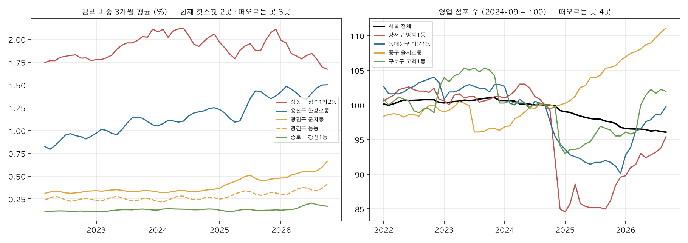

### 5.5 네 리스트를 함께 보면

1. **현재 핫스팟은 거의 겹치지 않는다.** 겹치는 곳은 한강로동 하나뿐이다. 검색은 "놀러 가는 곳"(성수, 용산, 잠실), 개업은 "가게가 많고 교체가 잦은 곳"(삼성, 여의도, 역삼)을 보여 준다. 관심과 공급은 다른 지표다.
2. **떠오르는 곳은 아예 겹치지 않는다.** 검색이 뜨는 광진구 일대는 아직 점포가 늘지 않았다. 이는 §3.5의 결과(3개월 예측에서 서로 돕지 않음)와 맞는다. 관심이 먼저 오고 가게가 뒤따른다면 **광진구 일대는 앞으로 개업 증가를 지켜볼 후보**다.
3. **"떠오르는 곳"은 예측이 아니라 지금 상태다.** 순증률 순위는 해마다 거의 바뀌고(§4 ③), 검색 비중 변화는 되돌아가는 경향이 있다(§4 ④). 그나마 믿을 만한 곳은 두 가지다. 2년 연속 늘어난 **을지로동**, 6·12개월 모두 오르고 이웃 동이 함께 오르는 **광진구 군자역~아차산 일대**.

---

## 6. 한계와 주의

- **학습 기간이 짧다.** F2024는 24개월뿐이라 AutoARIMA가 대부분 계절 항 없는 단순 차수를 골랐다. 그래서 SARIMA·SARIMAX가 계절성을 충분히 쓰지 못했을 수 있다.
- **검정 표본이 작다.** DM 검정은 fold당 origin 10개(h = 3), 7개(h = 6)이고 예측 구간이 서로 겹친다. p값은 참고로 본다.
- **MASE 분모가 짧은 구간에서 나온다.** 학습 구간 계절 naive 오차가 우연히 작으면 MASE가 크게 나온다.
- **검색은 상대 지수다.** "몇 건"으로 읽을 수 없다. 전국 검색이라 다른 지역 검색이 일부 섞일 수 있다.
- **행정동에 못 붙인 점포가 6.3%다.** 대부분 오래된 기록이다. 최근 개업은 연 0.4~1.7%만 빠진다.
- **핫스팟 리스트는 2026년 자료를 본 기술 통계다.** 최종 시험 전에 이 리스트를 보고 모델을 바꾸지 않는다.

---

## 7. 다음 할 일

| 항목 | 내용 | 필요한 결정 |
|---|---|---|
| 최종 시험 | 모든 선택을 고정하고 커밋한 뒤 2026-01~09를 한 번 실행 (`--final`) | 실행 시점 |
| 프랜차이즈·독립카페 | 계획의 보조 대상(독립카페 진입률, 프랜차이즈 비중)은 아직 안 함 | 판별 방식: 브랜드 목록 또는 같은 상호 빈도 |
| 매핑 안 된 업태 | 53개 점포 제외 중 (`reports/unmapped_categories.csv`) | 매핑표에 넣을지 |
| 재등록 처리 | 같은 날 대량 개업 + 일괄 폐업 동(장충·묵2·공릉2 등)의 개업도 `v_drop`에서 뺄지 | 규칙 추가 여부 (결과 보기 전 정한 규칙이 아니므로 민감도로만) |
| 선후 관계 분석 | 검색 ↔ 개폐업의 시차 관계 (국소 투영, 사전백색화 교차상관) | v2 계획 Phase 5 |

---

## 8. 파일과 다시 만들기

```bash
.venv/bin/python src/forecast/00_targets.py     # 대상 테이블 (data/interim/forecast/)
.venv/bin/python src/forecast/01_checks.py      # 데이터 점검 -> 01_checks.md
.venv/bin/python src/forecast/02_baselines.py   # Naive, Seasonal Naive
.venv/bin/python src/forecast/03_local.py       # ETS, Theta, SARIMA, Croston, TSB (약 15분)
.venv/bin/python src/forecast/04_sarimax.py     # SARIMAX
.venv/bin/python src/forecast/05_global.py      # LightGBM, Ridge (약 15분)
.venv/bin/python src/forecast/06_evaluate.py    # 지표·표·그림 -> 06_*.csv, 06_tables.md
.venv/bin/python src/forecast/07_hotspots.py    # 핫스팟 리스트 -> 07_*.csv
.venv/bin/python src/forecast/08_report_figures.py  # 이 리포트의 그림 -> 08_fig_*.png
```

| 파일 | 내용 |
|---|---|
| `01_checks.md`, `01_checks_seoul_monthly.png` | 데이터 점검 |
| `06_metrics.csv` | 대상 × 수준 × 범위 × fold × h × 모델별 MASE, MAE, Poisson deviance |
| `06_dm.csv` | DM-HLN 검정 (계절 naive·Naive 대비, 교차 피처 넣고 빼기) |
| `06_topk.csv` | top-10·20·30 적중률 |
| `06_tables.md` | 모든 표 (h = 3, 6, 12) |
| `05_feature_importance.csv` | LightGBM 피처 중요도 |
| `07_hotspots_*.csv`, `07_hotspot_trends.png` | 4개 리스트와 뺀 동, 추이 |
| `08_fig_*.png` | 이 리포트의 그림 8개 |
| `results/forecast/pred_*.parquet` | 모든 예측값 (git 제외) |

- 음식점 원자료(`data/interim/음식점_*.csv`)는 git에 없다. 팀 폴더(`시계열데이터분석및실습/플젝/전처리_결과/`)의 파일을 링크해서 썼다.
- 실행 기록은 `experiments/log.csv`에 남는다.
