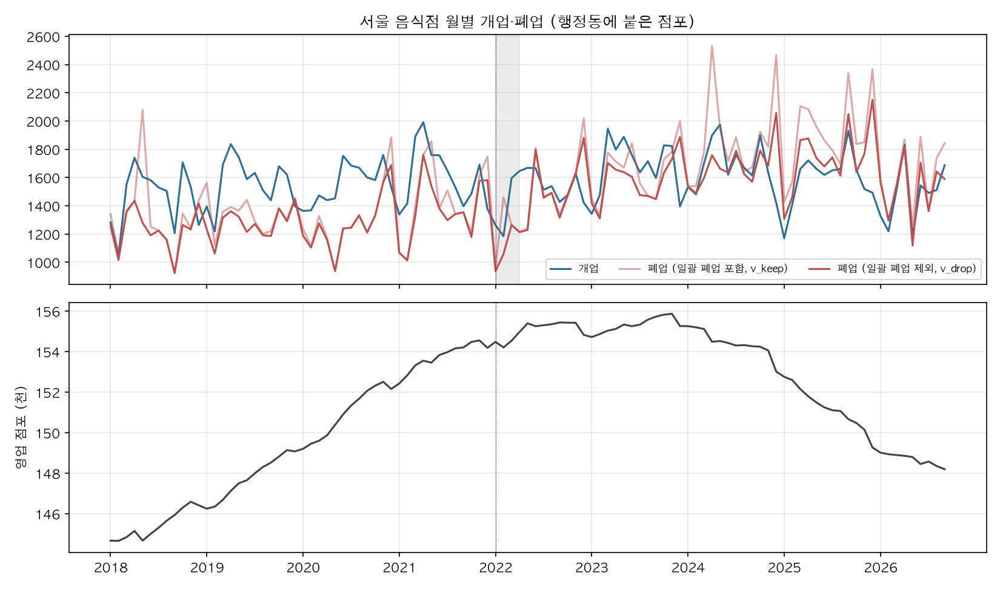

# 개폐업 기본 점검

> `src/forecast/01_checks.py` 결과. 일반·휴게음식점 합침, 매핑표 `include == 1` 업종만.

## 1. 행정동에 붙인 비율

- 포함 업종 점포 664,496개 중 **622,857개(93.7%)**를 좌표로 행정동에 붙였다.
- 좌표를 못 쓰는 점포 41,546개 (결측·범위 밖). 나머지 차이는 좌표가 서울 경계 밖인 점포.
- 개업 연도별로 못 붙인 비율 (2018년 이후):

| 개업 연도 | 점포 수 | 못 붙인 비율 |
|---|---:|---:|
| 2018 | 17,708 | 0.9% |
| 2019 | 18,848 | 0.5% |
| 2020 | 18,746 | 0.4% |
| 2021 | 19,361 | 0.4% |
| 2022 | 18,115 | 0.5% |
| 2023 | 20,314 | 0.6% |
| 2024 | 20,354 | 0.7% |
| 2025 | 19,268 | 0.6% |
| 2026 | 13,881 | 1.7% |

못 붙인 점포는 동·구·서울 집계에서 모두 빠진다(서울 = 동 합계). 비율이 연도마다 비슷하면 추세 왜곡은 작다.

## 2. 매핑표에 없는 업태

- 16개 업태, 53개 점포. 추측해서 넣지 않고 **제외**했다. 목록: `reports/unmapped_categories.csv`

| 출처 | 업태 | 점포 수 |
|---|---|---:|
| 일반음식점 | (결측) | 18 |
| 일반음식점 | 푸드트럭 | 15 |
| 일반음식점 | 커피숍 | 4 |
| 일반음식점 | 기타 휴게음식점 | 3 |
| 일반음식점 | 일반조리판매 | 2 |
| 일반음식점 | 간이주점 | 1 |
| 일반음식점 | 다방 | 1 |
| 일반음식점 | 룸살롱 | 1 |
| 일반음식점 | 식품등 수입판매업 | 1 |
| 일반음식점 | 식품소분업 | 1 |
| 일반음식점 | 제과점영업 | 1 |
| 휴게음식점 | 기타 | 1 |
| 휴게음식점 | 단란주점 | 1 |
| 휴게음식점 | 룸살롱 | 1 |
| 휴게음식점 | 한식 | 1 |
| 휴게음식점 | 호프/통닭 | 1 |

## 3. 일괄 폐업 (`bulk_closure`)

- 규칙: 같은 동·같은 폐업일 건수 ≥ 그 동 일평균 × 10, 그리고 ≥ 10건 (2015년 이후 폐업 기준).
- 해당: 599건(동·날짜), 점포 11,306개.

| 연도 | 일괄 폐업 건 | 점포 | 그해 전체 폐업 중 비율 |
|---|---:|---:|---:|
| 2018 | 49 | 1,116 | 7.0% |
| 2019 | 41 | 814 | 5.1% |
| 2020 | 20 | 318 | 2.0% |
| 2021 | 44 | 832 | 4.8% |
| 2022 | 30 | 649 | 3.7% |
| 2023 | 45 | 797 | 4.0% |
| 2024 | 112 | 2,262 | 10.1% |
| 2025 | 112 | 2,001 | 8.7% |
| 2026 | 43 | 781 | 5.3% |

가장 큰 일괄 폐업 10건:

| 날짜 | 구 | 동 | 점포 |
|---|---|---|---:|
| 2024-04-17 | 마포구 | 서교동 | 185 |
| 2022-02-08 | 마포구 | 서교동 | 152 |
| 2023-06-26 | 강남구 | 역삼2동 | 95 |
| 2024-03-12 | 종로구 | 종로1·2·3·4가동 | 78 |
| 2025-12-04 | 마포구 | 서교동 | 63 |
| 2025-04-29 | 영등포구 | 영등포동 | 62 |
| 2025-08-31 | 노원구 | 공릉2동 | 60 |
| 2025-04-08 | 영등포구 | 여의동 | 58 |
| 2024-03-19 | 종로구 | 이화동 | 54 |
| 2026-05-17 | 중랑구 | 묵2동 | 53 |

- 2022~2025 서울 월 폐업: 유지(`v_keep`) 평균 1719, 제외(`v_drop`) 평균 1600.
- 2022년 이후 일괄 폐업 점포가 많은 달: 4월 17%, 12월 14%, 6월 11%. 2024년부터 일괄 폐업이 두 배 넘게 늘어 폐업 추세를 왜곡할 수 있다.
- 두 패널 모두 모델을 돌린다. 기본 보고는 `v_drop`. 영업 점포 수 S는 두 패널 공통(등록 상태 그대로).

## 4. 폐업 신고 지연

### 4.1 폐업일과 최종수정일 차이 (2022~2024 폐업)

- 최종수정일이 폐업일보다 앞선 기록은 0.8%로 적다. 대부분 폐업 처리일에 기록이 수정됐다고 보고, 차이가 0 이상인 기록으로 지연을 잰다. (2021년 이전 폐업은 수정일이 폐업일보다 앞선 기록이 많아 보지 않는다.)
- 중앙값 0일, 75% 0일, 90% 1일, 95% 2일.
- 차이가 30일 이내: 99%, 90일 이내: 100%, 180일 이내: 100%.

### 4.2 최근 달 폐업 수를 전년 같은 달과 비교

신고가 늦게 들어온다면 자료 끝 쪽 달의 폐업이 개업보다 더 크게 낮아 보인다. 개업 대비 폐업 비율(C/O)을 전년 같은 달과 비교한다.

| 달 | 개업 | 폐업(v_drop) | C/O | 전년 같은 달 C/O |
|---|---:|---:|---:|---:|
| 2025-07 | 1,651 | 1,742 | 1.06 | 1.02 |
| 2025-08 | 1,660 | 1,613 | 0.97 | 0.97 |
| 2025-09 | 1,930 | 2,048 | 1.06 | 0.97 |
| 2025-10 | 1,653 | 1,639 | 0.99 | 0.94 |
| 2025-11 | 1,518 | 1,768 | 1.16 | 1.03 |
| 2025-12 | 1,492 | 2,150 | 1.44 | 1.45 |
| 2026-01 | 1,328 | 1,567 | 1.18 | 1.12 |
| 2026-02 | 1,219 | 1,295 | 1.06 | 1.04 |
| 2026-03 | 1,510 | 1,540 | 1.02 | 1.12 |
| 2026-04 | 1,832 | 1,818 | 0.99 | 1.09 |
| 2026-05 | 1,180 | 1,118 | 0.95 | 1.05 |
| 2026-06 | 1,544 | 1,705 | 1.10 | 1.04 |
| 2026-07 | 1,490 | 1,363 | 0.91 | 1.06 |
| 2026-08 | 1,512 | 1,642 | 1.09 | 0.97 |
| 2026-09 | 1,687 | 1,589 | 0.94 | 1.06 |
| 2026-10 | 337 | 359 | 1.07 | 0.99 |

- 2026-01~09 C/O 1.03, 2025-01~09 1.06.
- 2026-10은 부분 월(자료 받은 날까지)이라 쓰지 않는다.
- 2026-05는 개업·폐업이 함께 낮다(전년 같은 달보다 각각 약 30%·35% 적음). 폐업만 낮은 것이 아니라 신고 지연의 모양은 아니다. 원인은 확인하지 못했다.
- **판단**: 폐업 기록의 99%가 폐업일 30일 안에 들어오고, 최근 달의 C/O도 전년과 비슷해 **신고 지연 영향은 작다**. 개발 fold 실제값(~2025-12)은 영향이 없다고 본다. 최종 시험(2026-01~09)도 지금 자료로 평가할 수 있지만, 마지막 달(2026-09)은 소수 누락이 있을 수 있어 결과에 함께 적는다.

## 5. 동별 0 비율과 모델 적용 범위 (F2024 학습 구간 2022~2023 기준)

- 동 427개. 월 개업 중앙값 2건, 폐업 중앙값 2건.
- 개업 또는 폐업이 0인 달이 30% 이상인 동(Croston/TSB 적용): **102개**
- 월평균 개업+폐업 ≥ 10건인 동(SARIMA 적용): **84개**
- 0인 달 비율 분포: 개업 평균 16.1%, 폐업 평균 17.3%

