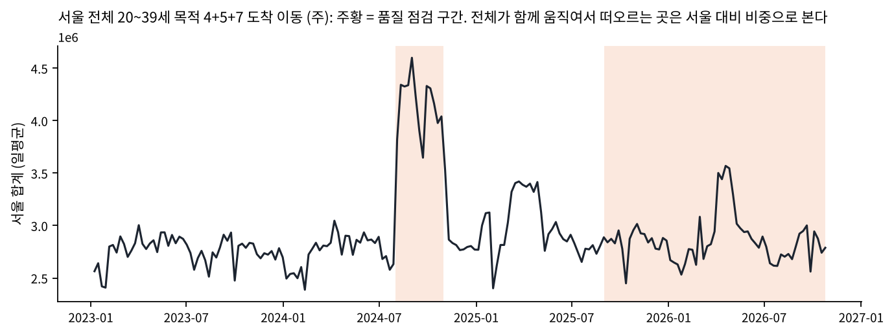
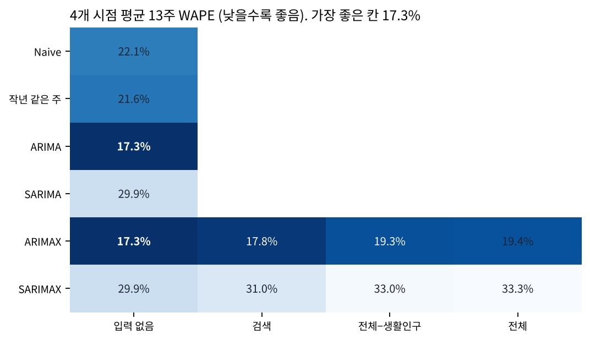
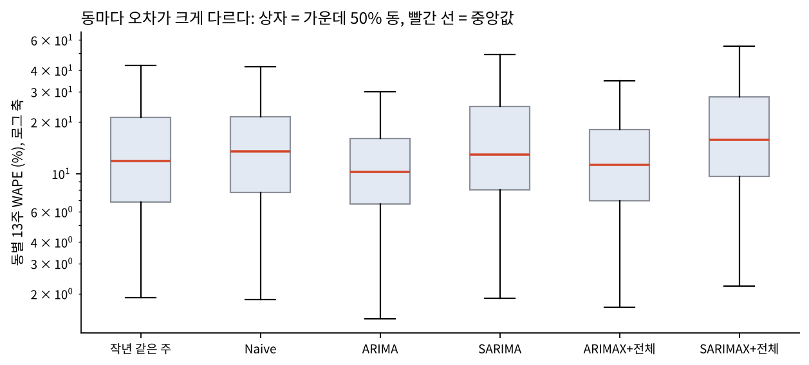
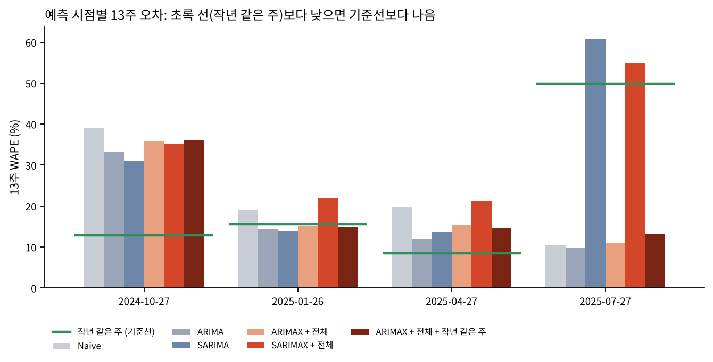
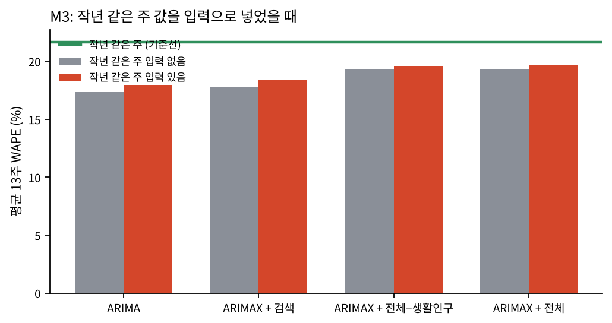
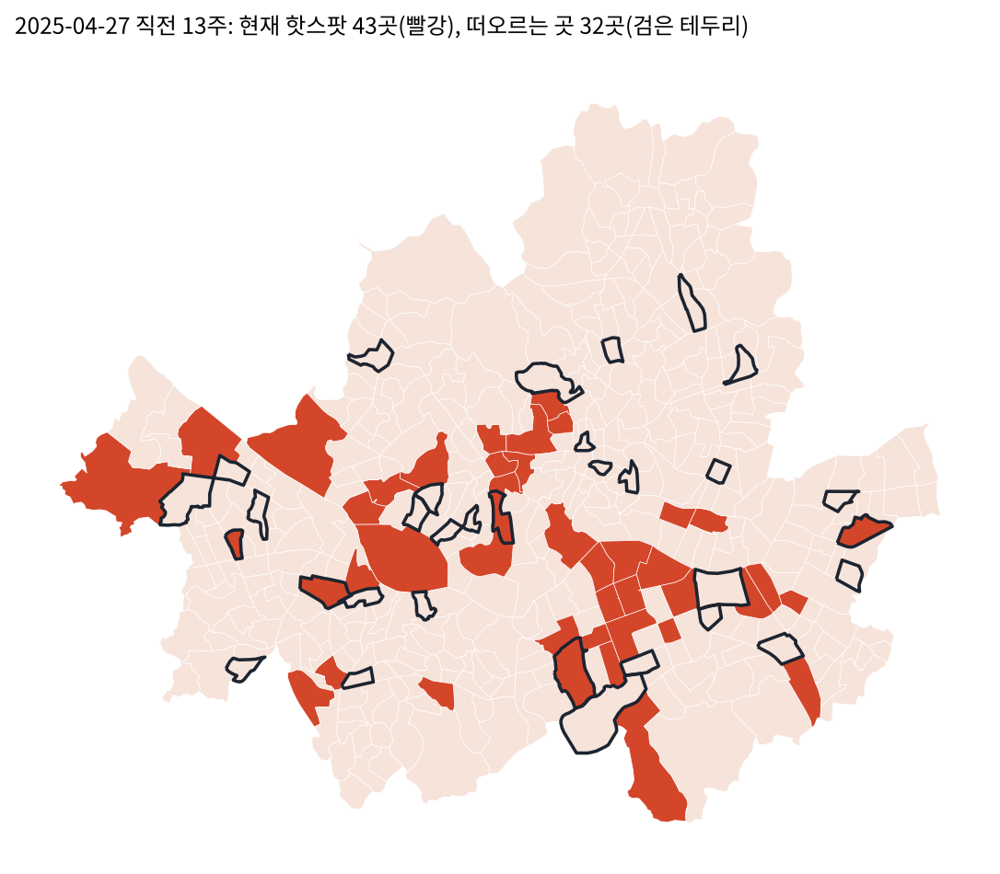
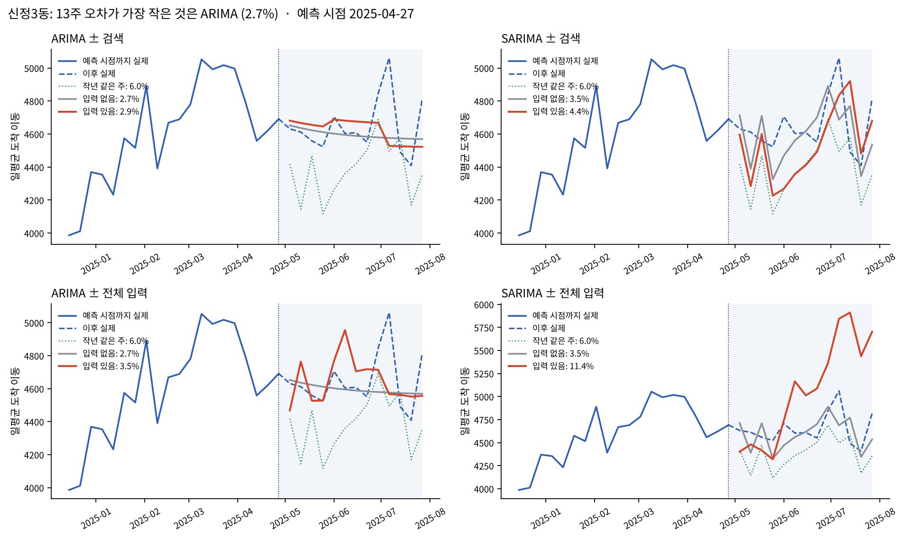
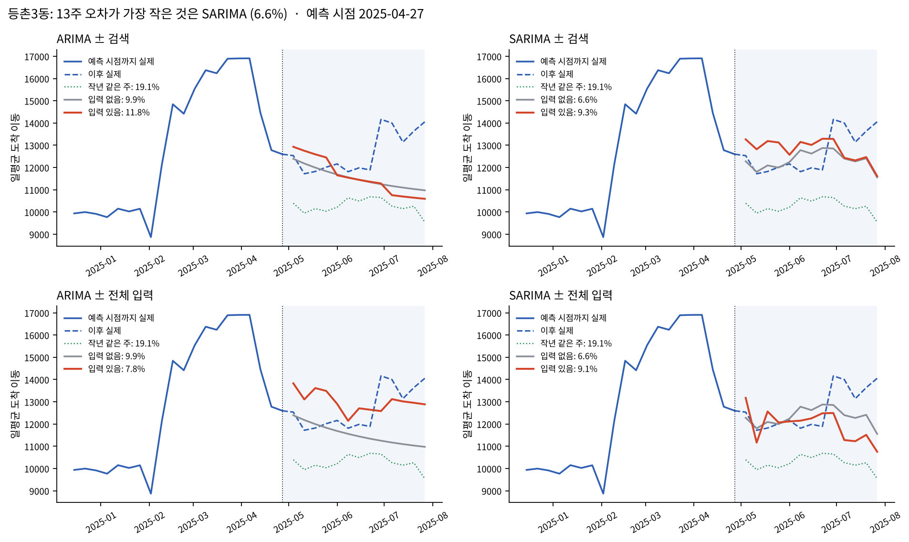
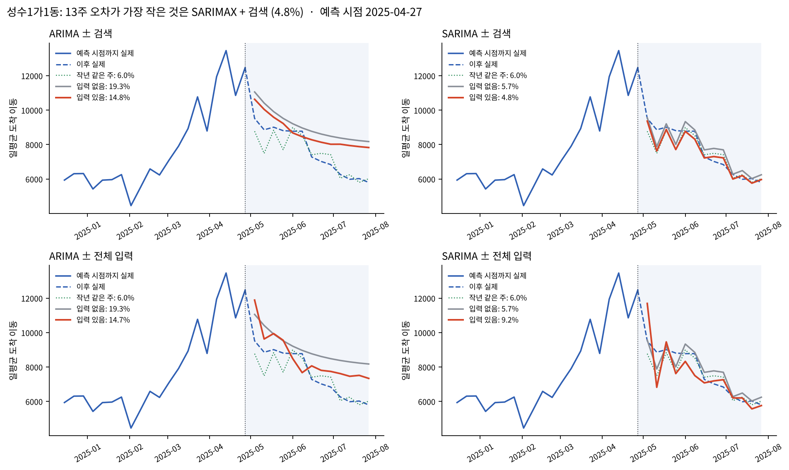
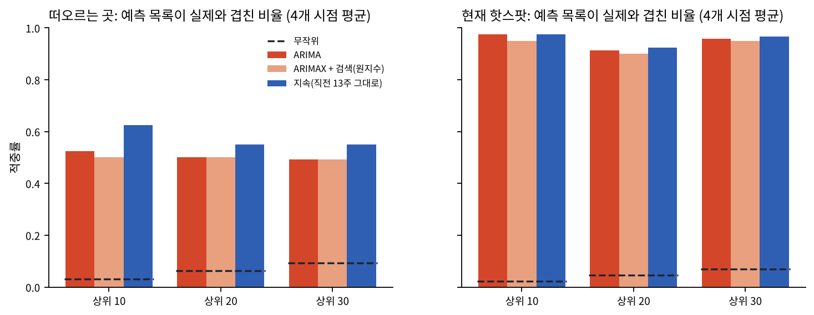

# 중간발표 실험 결과: 생활이동 13주 예측과 핫스팟 판정

> 만든 날 2026-11-16 · 코드 `src/gt/` · 명세 `docs/experiments/midterm_experiments.md` · 다시 돌리기 `bash src/gt/run_all.sh`

> 숫자는 모두 `reports/gt_midterm/tables/`의 CSV에서 나온 값이다. 그림은 `reports/gt_midterm/fig/`.

## 0. 한눈에 보기

1. **초안과 같은 조건에서 숫자가 재현된다.** 2025-04-27 시점 작년 같은 주 WAPE 8.5% (초안 8.52%). 정답 정의와 동 대응이 맞다.
2. **4개 시점 평균으로는 ARIMA가 가장 좋다** (17.3%, 작년 같은 주 21.6%). 하지만 서울 전체 오차로 본 DM 검정에서는 차이가 유의하지 않다 (p = 0.77).
3. **결과가 시점에 따라 크게 뒤집힌다.** 원인은 **2024년 8~10월 자료 이상**(서울 전체가 앞뒤 달의 1.45배). 이 구간이 끼지 않은 두 시점만 보면 작년 같은 주가 12.0%로 다시 1등이다.
4. **외생변수(검색·음식점·지하철·생활인구)를 넣으면 대체로 나빠진다.** ARIMA 17.3% → ARIMAX + 전체 19.4%. 동별로 봐도 좋아진 동이 절반이 안 된다.
5. **핫스팟 순위는 무작위보다 훨씬 잘 맞지만 '지금 순위 그대로'를 넘지 못했다.** 상위 10% 적중률: 현재 핫스팟 약 90%, 떠오르는 곳 약 50% (무작위 10%). 지속 기준도 비슷하거나 더 높다.
6. **떠오르는 곳에는 상권보다 새 아파트 입주 같은 생활권 변화가 많이 잡힌다.** 정답의 대부분이 목적 7(기타)이기 때문이다. 해석할 때 주의가 필요하다.

## 1. 무엇을 했나

| 항목 | 내용 |
|---|---|
| 정답 | 생활이동(OA-22298) 20~39세 남녀, 목적 4(쇼핑)+5(관광)+7(기타), 도착 행정동, 주(월~일) 일평균 |
| 지역 | 이름표 427동(2025-12-31 경계). 신설동·용두동은 생활이동에서 나뉘기 전 코드(용신동)만 있어 합침 → 분석 단위 426개. 4개 시점 모두 예측이 있는 공통 416개 단위로 평가 |
| 기간 | 2023-01 ~ 2026-10 (주 199개). 학습은 2023-01부터 |
| 예측 | 13주 앞, 주 단위. 예측 시점 4개: 2024-10-27, 2025-01-26, 2025-04-27, 2025-07-27 |
| 모델 | Naive(지난주), 작년 같은 주(364일 전), ARIMA, SARIMA(계절 차분 52주), ARIMAX, SARIMAX. 모두 log1p(y)에 적합 |
| 입력 | 검색(서울 대비 비중, 4개월 전 달), 음식점 영업점포 12개월 변화(4개월 전 달), 지하철 하차 4주 평균(13주 전), 생활인구(13주 전), 공휴일 수(시차 없음), 작년 같은 주 값(M3) |
| 지표 | WAPE(13주 오차 합 / 실제 합), MASE(작년 같은 주 기준), 동별 개선 비율 + Wilcoxon, DM-HLN(서울 합 오차), 상위 K개 적중률 |

- 입력은 모두 **고정 시차**로 붙였다. 13주 앞 예측의 마지막 주에도 예측 시점 이전 값만 쓰게 하려는 것이다 (`00_leakage_test.md`에서 확인).
- 차수: ARIMA는 p∈{0,1,2}, d∈{0,1}, q∈{0,1} 중 AIC 최소. 외생변수 모델은 같은 차수를 그대로 쓴다. 적합 실패로 대체한 경우는 0건, 수렴 경고는 362건(전체 적합의 1% 미만).
- 행사 급등 처리는 하지 않았다 (다음 단계). 급등 주와 품질 구간은 표시만 했다.

## 2. 자료 점검: 2024년 8~10월 이상

- 서울 전체 20~39세 목적 4+5+7 도착 이동이 2024-08~10에만 앞뒤 달의 **1.45배**로 뛰었다가 11월에 원래 수준으로 돌아온다. 다른 해 같은 달에는 이런 움직임이 없어 실제 변화보다는 자료 쪽 문제로 보인다.
- 이 구간은 두 시점의 결과를 크게 흔든다.
  - **2024-10-27 시점**: 학습 끝부분이 부풀어 있어 지난주 값·ARIMA가 높게 예측 → 크게 틀림. 작년 같은 주는 2023년 값을 써서 괜찮다.
  - **2025-07-27 시점**: 예측 구간(2025-08~10)의 작년 같은 주가 부푼 2024년 값 → 작년 같은 주·SARIMA가 크게 틀림.
- 그래서 아래 표마다 **4개 시점 평균**과 **이상 구간이 끼지 않은 2개 시점(2025-01-26, 2025-04-27) 평균**을 함께 적는다. 어느 쪽이 '진짜' 성능인지는 자료 제공처 확인이 필요하다.

## 3. M1 결과표 확장: 모델 × 입력

4개 시점 평균 13주 WAPE (%). 낮을수록 좋다. 입력 없음 열의 ARIMAX = ARIMA, SARIMAX = SARIMA.

|            |   입력 없음 | 검색   | 전체−생활인구   | 전체   |
|:-----------|--------:|:-----|:----------|:-----|
| Naive(지난주) |    22.1 | –    | –         | –    |
| 작년 같은 주    |    21.6 | –    | –         | –    |
| ARIMA      |    17.3 | –    | –         | –    |
| SARIMA     |    29.9 | –    | –         | –    |
| ARIMAX     |    17.3 | 17.8 | 19.3      | 19.4 |
| SARIMAX    |    29.9 | 31.0 | 33.0      | 33.3 |

| 모델 | WAPE 4시점 | WAPE 2시점(이상 구간 제외) | MASE 중앙값 | 작년 같은 주보다 좋아진 동 | DM vs 작년 같은 주 |
|---|---|---|---|---|---|
| Naive(지난주) | 22.1 | 19.4 | 1.02 | 45% | +0.06 (p=0.95) |
| 작년 같은 주 | 21.6 | 12.0 | 0.87 | – | – |
| ARIMA | 17.3 | 13.2 | 0.76 | 53% | -0.29 (p=0.77) |
| SARIMA | 29.8 | 13.8 | 0.93 | 42% | +1.58 (p=0.12) |
| ARIMAX + 검색 | 17.8 | 13.8 | 0.79 | 53% | -0.27 (p=0.79) |
| ARIMAX + 전체−생활인구 | 19.3 | 15.1 | 0.83 | 54% | -0.15 (p=0.88) |
| ARIMAX + 전체 | 19.4 | 15.2 | 0.83 | 53% | -0.15 (p=0.88) |
| SARIMAX + 검색 | 31.0 | 15.9 | 1.03 | 39% | +1.97 (p=0.05) |
| SARIMAX + 전체−생활인구 | 33.1 | 21.2 | 1.16 | 38% | +2.89 (p=0.01) |
| SARIMAX + 전체 | 33.3 | 21.6 | 1.17 | 37% | +2.98 (p=0.00) |

- MASE < 1이면 작년 같은 주(학습 구간)보다 오차가 작다는 뜻. DM 통계량이 음수면 작년 같은 주보다 낫다는 방향.
- **계절(SARIMA)**: 4시점 평균 29.8%로 ARIMA보다 나쁘다. 2025-07 시점의 이상 구간 영향이 크다. 2시점에서는 13.8%로 ARIMA(13.2%)와 비슷하다.
- **입력(외생변수)**: 넣을수록 나빠졌다. 아래는 같은 차수의 입력 없는 모델과 비교한 것이다.

| 모델 | 비교 대상 | WAPE 차이 4시점 (%p) | 2시점 (%p) | 좋아진 동 | Wilcoxon p |
|---|---|---|---|---|---|
| ARIMAX + 검색 | ARIMA | 0.5 | 0.6 | 45% | 0.000 |
| ARIMAX + 전체−생활인구 | ARIMA | 2.0 | 1.9 | 45% | 0.000 |
| ARIMAX + 전체 | ARIMA | 2.0 | 2.0 | 46% | 0.000 |
| SARIMAX + 검색 | SARIMA | 1.1 | 2.1 | 43% | 0.000 |
| SARIMAX + 전체−생활인구 | SARIMA | 3.2 | 7.4 | 41% | 0.000 |
| SARIMAX + 전체 | SARIMA | 3.4 | 7.8 | 41% | 0.000 |

  해석: 13주 시차를 둔 입력은 예측 구간의 변화와 잘 맞지 않고, 한 동당 학습 주가 90~130개라 입력 계수가 불안정하다. 입력을 하나씩 넣고 빼는 실험(F1)과 입력 모양 바꾸기(최근값 고정, 변화율 등)는 최종 발표 전 과제로 남긴다.

**동별 오차 분포** (13주 WAPE, 4시점 × 동)

|              |   10% |   25% |   중앙값 |   75% |   90% |
|:-------------|------:|------:|------:|------:|------:|
| 작년 같은 주      |   4.5 |   6.8 |  11.9 |  21.2 |  38.8 |
| Naive(지난주)   |   4.7 |   7.8 |  13.4 |  21.5 |  34   |
| ARIMA        |   4.4 |   6.7 |  10.2 |  16   |  24.5 |
| SARIMA       |   5.4 |   8   |  12.9 |  24.6 |  46.1 |
| ARIMAX + 전체  |   4.5 |   6.9 |  11.2 |  18   |  28.4 |
| SARIMAX + 전체 |   6.7 |   9.6 |  15.7 |  28   |  47.6 |

- 오차는 동마다 크게 다르다. 중앙값 동은 10% 안팎이지만 상위 10% 동은 30~50%를 넘는다. 평균만 보면 이 차이가 가려진다.

## 4. M2 예측 시점 추가: 결론이 시점마다 유지되나

|                     |   2024-10-27 |   2025-01-26 |   2025-04-27 |   2025-07-27 |   4시점 평균 |   2시점 평균 (이상 제외) |
|:--------------------|-------------:|-------------:|-------------:|-------------:|---------:|-----------------:|
| Naive(지난주)          |         39   |         19.1 |         19.7 |         10.4 |     22.1 |             19.4 |
| 작년 같은 주             |         12.8 |         15.5 |          8.5 |         49.8 |     21.6 |             12   |
| ARIMA               |         33.1 |         14.5 |         12   |          9.7 |     17.3 |             13.2 |
| SARIMA              |         31.1 |         13.9 |         13.7 |         60.7 |     29.8 |             13.8 |
| ARIMAX + 검색         |         32.8 |         14.3 |         13.2 |         10.9 |     17.8 |             13.8 |
| ARIMAX + 전체         |         35.9 |         15.2 |         15.3 |         11   |     19.4 |             15.2 |
| SARIMAX + 전체        |         35.1 |         22   |         21.2 |         54.9 |     33.3 |             21.6 |
| ARIMAX + 작년 같은 주 입력 |         33.4 |         14.2 |         11.7 |         12.6 |     18   |             12.9 |

- 시점별 1등: 2024-10-27 작년 같은 주 (12.8%), 2025-01-26 SARIMA (13.9%), 2025-04-27 작년 같은 주 (8.5%), 2025-07-27 ARIMA (9.7%).
- **'작년 같은 주가 가장 강하다'는 초안의 결론은 이상 구간이 없는 시점에서만 유지된다.** 이상 구간이 학습 끝에 걸리면 지난주 기반 모델이, 작년 값에 걸리면 작년 기반 모델이 무너진다.
- 발표에서는 4시점 평균만 보여주지 말고 이 그림처럼 시점별로 보여주는 것이 정직하다.

## 5. M3 작년 같은 주를 입력으로

| xset             |   4시점 입력 없음 |   4시점 입력 있음 |   2시점 입력 없음 |   2시점 입력 있음 |   작년 같은 주(기준선) 4시점 |
|:-----------------|------------:|------------:|------------:|------------:|-------------------:|
| ARIMA            |        17.3 |        17.9 |        13.2 |        12.9 |               21.6 |
| ARIMAX + 검색      |        17.8 |        18.4 |        13.8 |        13.6 |               21.6 |
| ARIMAX + 전체−생활인구 |        19.3 |        19.6 |        15.1 |        14.6 |               21.6 |
| ARIMAX + 전체      |        19.4 |        19.7 |        15.2 |        14.7 |               21.6 |

- 4시점 평균으로는 조금 나빠지고(동별 좋아진 비율 50%, p = 0.33), 2시점에서는 ARIMA 13.2% → 12.9%로 좋아진다. 입력이 있는 모델 중 2시점 기준 가장 좋다.
- 그래도 작년 같은 주 자체(12.0%)는 넘지 못했다. 연간 패턴을 계수 하나로 넣는 방법은 가능성은 있지만, 이번 결과만으로 '넘는다'고 말할 수 없다.
- 작년 값이 이상 구간에 걸리면 이 입력도 같이 오염된다. 이상 구간 처리(다음 단계)와 묶어서 다시 봐야 한다.

## 6. M4 검색 입력을 서울 대비 비중으로

| model        |   원래 검색 지수 |   서울 대비 비중 |
|:-------------|-----------:|-----------:|
| ARIMAX + 검색  |       17.6 |       17.8 |
| SARIMAX + 검색 |       33.6 |       31   |

- ARIMAX: 비중이 좋아진 동 49%, Wilcoxon p = 0.0687.
- SARIMAX: 비중이 좋아진 동 54%, Wilcoxon p = 0.0001.
- ARIMAX에서는 차이가 없고 SARIMAX에서는 비중이 유의하게 낫다. 비중으로 바꾼 결정을 유지한다.
- 떠오르는 곳 판정도 비중(서울 대비 몫)의 증가율로 계산했다. 2024-08~10처럼 서울 전체가 함께 출렁일 때 비중은 그 영향을 대부분 지운다.

## 7. M5 핫스팟 목록과 동네 예시

정의 (README §2.2): **현재 핫스팟** = 13주 평균 상위 10%. **떠오르는 곳** = 13주 평균 서울 대비 비중의 1년 전 같은 13주 대비 증가율 상위 10%, 규모 하위 25% 제외.

**2025-04-27 직전 13주 (판정 시점에 아는 것)**

| 순위 | 현재 핫스팟 | 13주 일평균 | 떠오르는 곳 | 비중 증가율 |
|---|---|---|---|---|
| 1 | 마포구 서교동 | 85,527 | 강동구 둔촌1동 | +222% |
| 2 | 강남구 역삼1동 | 82,230 | 구로구 개봉3동 | +108% |
| 3 | 영등포구 여의동 | 70,546 | 강서구 발산1동 | +79% |
| 4 | 종로구 종로1·2·3·4가동 | 63,601 | 중랑구 상봉1동 | +72% |
| 5 | 용산구 한강로동 | 51,289 | 노원구 월계3동 | +69% |
| 6 | 서대문구 신촌동 | 44,436 | 관악구 조원동 | +59% |
| 7 | 송파구 잠실6동 | 44,113 | 강서구 등촌2동 | +54% |
| 8 | 강남구 삼성1동 | 40,523 | 송파구 잠실7동 | +49% |
| 9 | 서초구 서초3동 | 37,871 | 강동구 암사1동 | +32% |
| 10 | 중구 명동 | 36,010 | 성북구 길음2동 | +32% |

**2025-04-27 이후 13주 실제 (맞혀야 할 것)**

| 순위 | 현재 핫스팟 | 13주 일평균 | 떠오르는 곳 | 비중 증가율 |
|---|---|---|---|---|
| 1 | 마포구 서교동 | 77,671 | 강동구 둔촌1동 | +210% |
| 2 | 강남구 역삼1동 | 71,062 | 강동구 암사1동 | +101% |
| 3 | 영등포구 여의동 | 62,892 | 마포구 염리동 | +81% |
| 4 | 종로구 종로1·2·3·4가동 | 60,116 | 노원구 월계3동 | +75% |
| 5 | 용산구 한강로동 | 50,637 | 관악구 조원동 | +73% |
| 6 | 송파구 잠실6동 | 39,733 | 강서구 등촌2동 | +73% |
| 7 | 서대문구 신촌동 | 38,137 | 구로구 개봉3동 | +69% |
| 8 | 강남구 삼성1동 | 37,113 | 중랑구 상봉1동 | +63% |
| 9 | 중구 명동 | 32,555 | 강서구 화곡8동 | +43% |
| 10 | 서초구 서초3동 | 32,036 | 성북구 길음2동 | +37% |

- 현재 핫스팟은 서교동(홍대), 역삼1동, 여의동, 종로, 한강로동(용산), 신촌, 잠실, 삼성, 명동처럼 누구나 아는 곳이 나온다. 정의가 상식과 맞는다.
- 떠오르는 곳 1위 둔촌1동(+222%)은 2024년 말 올림픽파크포레온(둔촌주공 재건축) 입주 시기와 겹치는 것으로 보인다. 그 밖에도 주거지 동이 많다.
  - 정답의 대부분이 목적 7(기타)이기 때문이다 (20~39세 이동 중 목적 7이 46.5%, 쇼핑 0.6%, 관광 0.1%).
  - 목적 4+5만 쓰면 0이 아닌 동이 38개뿐이라(원자료가 작은 값을 감춘 것으로 보임) 대안이 되지 못한다.
  - 그래서 '떠오르는 곳 = 사람들이 새로 많이 오기 시작한 동'으로 설명하고, 상권 해석은 검색·음식점 자료와 함께 붙이는 것이 맞다.

**정의 바꿔 보기 (실제 다음 13주 떠오르는 곳 목록과 겹치는 비율)**

| variant   | 2024-10-27   | 2025-01-26   | 2025-04-27   | 2025-07-27   | 평균   |
|:----------|:-------------|:-------------|:-------------|:-------------|:-----|
| 규모 제외 없음  | 68%          | 68%          | 56%          | 26%          | 55%  |
| 전 연령      | 52%          | 68%          | 60%          | 42%          | 56%  |
| 목적 4+5    | 0%           | 0%           | 6%           | 6%           | 3%   |

- 규모 하위 25%를 빼지 않으면 목록의 절반 가까이 바뀐다 (작은 동은 비율이 쉽게 튄다). 규모 제외 규칙이 필요하다.
- 전 연령으로 바꿔도 절반쯤 겹친다. 20~39세 정의가 목록을 꽤 바꾼다.
- 목적 4+5는 위 이유로 비교 불가 (뽑히는 동이 4곳).

**동네 예시** (대표 모델 기준. 결과를 본 뒤 규칙으로 골랐다)

대표 모델 = 4개 시점 평균 WAPE가 가장 낮은 모델 중 작년 같은 주를 뺀 것: **ARIMA**. 작년 같은 주는 모든 동의 예측 증가율이 0이라 떠오르는 곳을 가릴 수 없어 뺐다.

| 역할 | 동 | 고른 규칙 | 2025-04-27 대표 모델 13주 WAPE | 416개 중 순위 (1 = 가장 잘 맞음) |
|---|---|---|---|---|
| 잘 맞춘 곳 | 신정3동 | 규모 중앙값 이상 동 중 WAPE 최저 | 2.7% | 3 |
| 보통인 곳 | 등촌3동 | WAPE 중앙값에 가장 가까운 동 | 9.9% | 208 |
| 못 맞춘 곳 | 성수1가1동 | WAPE 상위 10% 경계에 가장 가까운 동 | 19.3% | 374 |

**잘 맞춘 곳: 신정3동** — 예측 시점 전 20주와 예측 13주(음영). 파란 실선 = 시점까지 실제, 파란 점선 = 이후 실제, 회색 = 입력 없음, 빨강 = 입력 있음, 초록 점선 = 작년 같은 주.

**보통인 곳: 등촌3동** — 예측 시점 전 20주와 예측 13주(음영). 파란 실선 = 시점까지 실제, 파란 점선 = 이후 실제, 회색 = 입력 없음, 빨강 = 입력 있음, 초록 점선 = 작년 같은 주.

**못 맞춘 곳: 성수1가1동** — 예측 시점 전 20주와 예측 13주(음영). 파란 실선 = 시점까지 실제, 파란 점선 = 이후 실제, 회색 = 입력 없음, 빨강 = 입력 있음, 초록 점선 = 작년 같은 주.

- 잘 맞춘 곳(신정3동)은 주별 변동이 작고 수준이 안정적이다. 회색(입력 없음) 선이 실제를 잘 따라간다. SARIMAX + 전체는 같은 동에서도 크게 벗어난다.
- 못 맞춘 곳(성수1가1동, 서울숲이 있는 동)은 해마다 봄(4월)·가을(10월)에 크게 치솟는 **계절이 강한 동**이다. 대표 모델 ARIMA는 계절을 모르고 봄 정점이 계속될 것처럼 천천히 내려와 19.3%가 틀렸다. 같은 동에서 작년 같은 주는 6.0%, SARIMA는 5.7%, SARIMAX + 검색은 4.8%로 잘 맞혔다 (`F1_case_성수1가1동.png`).
- 즉 서울 평균으로는 ARIMA가 낫지만, 계절이 뚜렷한 공원·관광 동에서는 계절 모델이 훨씬 낫다. 동의 성격에 따라 모델을 고르거나 섞는 방법(최종 과제)의 근거가 된다.
- 긴 기간 그림은 `fig/F1_case_<동>.png`.

## 8. M6 상위 K개 적중률

K = 상위 10%. 현재 핫스팟 K = 43곳, 떠오르는 곳 K = 32곳. 예측한 다음 13주 목록과 실제 다음 13주 목록이 겹친 비율.

**현재 핫스팟**

|                  | 2024-10-27   | 2025-01-26   | 2025-04-27   | 2025-07-27   | 평균   |
|:-----------------|:-------------|:-------------|:-------------|:-------------|:-----|
| 지속 (직전 13주 그대로)  | 98%          | 93%          | 98%          | 93%          | 95%  |
| SARIMA           | 93%          | 91%          | 93%          | 95%          | 93%  |
| ARIMAX + 검색(원지수) | 93%          | 91%          | 95%          | 91%          | 92%  |
| 작년 같은 주          | 93%          | 91%          | 91%          | 95%          | 92%  |
| ARIMA            | 93%          | 93%          | 93%          | 91%          | 92%  |
| SARIMAX + 검색     | 93%          | 91%          | 88%          | 95%          | 92%  |
| ARIMAX + 검색      | 93%          | 91%          | 93%          | 91%          | 92%  |
| 무작위              | 10%          | 10%          | 10%          | 10%          | 10%  |

**떠오르는 곳**

|                               | 2024-10-27   | 2025-01-26   | 2025-04-27   | 2025-07-27   | 평균   |
|:------------------------------|:-------------|:-------------|:-------------|:-------------|:-----|
| 지속 (직전 13주 그대로)               | 53%          | 59%          | 59%          | 38%          | 52%  |
| ARIMAX + 전체−생활인구 + 작년 같은 주 입력 | 34%          | 44%          | 66%          | 59%          | 51%  |
| ARIMAX + 작년 같은 주 입력           | 34%          | 50%          | 66%          | 50%          | 50%  |
| ARIMAX + 전체−생활인구              | 38%          | 47%          | 62%          | 53%          | 50%  |
| ARIMAX + 검색 + 작년 같은 주 입력      | 34%          | 47%          | 69%          | 47%          | 49%  |
| ARIMAX + 전체 + 작년 같은 주 입력      | 34%          | 41%          | 62%          | 59%          | 49%  |
| ARIMAX + 전체                   | 38%          | 44%          | 59%          | 53%          | 48%  |
| 무작위                           | 10%          | 10%          | 10%          | 10%          | 10%  |

- **현재 핫스팟**: 모든 모델이 90% 안팎. 하지만 '직전 13주 순위 그대로'(지속)도 95%라 모델이 보탤 것이 거의 없다. 붐비는 곳은 3개월 사이에 거의 바뀌지 않는다.
- **떠오르는 곳**: 무작위(10%)의 약 5배인 50% 안팎. 지속 기준과 비슷하다. 2025-04·07 시점에서는 ARIMAX 계열이 지속 기준을 넘었지만 2024-10·2025-01 시점에서는 졌다.
- 작년 같은 주는 떠오르는 곳 순위를 매길 수 없다 (예측 증가율이 모든 동 0). 그래서 '기준선 대비'가 아니라 '지속·무작위 대비'로 보고한다.
- 발표용 성공 기준 제안: '떠오르는 곳 상위 10% 중 절반을 13주 전에 맞힌다 (무작위 10%, 지속 52%)'. 지속 기준을 확실히 넘는 것은 최종 발표 목표로 둔다.

## 9. 한계

- **예측 시점 4개**: 시점 하나가 평균을 크게 바꾼다. 최종 전에는 시점을 매월로 늘린다(rolling origin).
- **2024-08~10 자료 이상**: 원인 미확인. 이 구간을 그대로 두고 평가했다. 제공처 확인 또는 해당 주 보정이 필요하다.
- **고정 시차**: 13주 앞 마지막 주까지 누수가 없도록 모든 주 입력을 13주 늦췄다. 가까운 주(h = 1~4)에는 더 최근 값을 쓸 수 있어 정보 손실이 있다.
- **목적 7 비중**: 정답이 상권 방문보다 넓은 '기타 이동'이다. 떠오르는 곳에 주거 변화가 섞인다.
- **생활인구 입력**: 생활인구와 생활이동은 같은 통신 자료에서 나와 겹친다. 넣어도 좋아지지 않았다.
- **동 하나씩 따로 적합**: 한 동당 학습 주가 적어 입력 계수가 불안정하다. 여러 동을 함께 쓰는 모델(패널, LightGBM)은 최종 과제.
- **2025-09 이후 자료**: 품질 점검 구간으로 표시만 했다. 이번 평가 구간(~2025-10)과 일부 겹친다.

## 10. 다음 단계 (최종 발표 전, 우선순위 순)

1. **2024-08~10 이상 처리**: 제공처 공지 확인 → 해당 주를 서울 합계 비율로 보정하거나 학습·평가에서 빼고 다시 비교. 결론이 가장 크게 바뀔 수 있는 항목이다.
2. **예측 시점 늘리기**: 2024-07 ~ 2025-07 매월 시점(13개)으로 평가해 시점 운을 줄인다.
3. **행사 급등 처리 (README F3)**: `flag_spike` 주를 학습에서 약하게 반영. 성수·여의도처럼 못 맞춘 동이 대상.
4. **입력 하나씩 넣고 빼기**: 지금은 한꺼번에 넣어 나빠졌다. 어떤 입력이 해를 끼치는지 분리한다. 입력을 '최근값 고정' 방식으로도 비교.
5. **떠오르는 곳 정의 다듬기**: 주거 변화(아파트 입주)를 가려낼 보조 신호로 검색·음식점 개업을 함께 본다.
6. **여러 동을 함께 쓰는 모델**: 패널 회귀, LightGBM(+같은 입력의 Ridge)으로 지속 기준을 넘는지 본다.

## 부록

**다시 돌리기**: `bash src/gt/run_all.sh` (자료 `data/raw/mobility`, `living_pop`, `subway` 필요. 전체 약 45분, 모델 단계가 대부분)

| 단계 | 파일 | 출력 |
|---|---|---|
| 정답 | `00_target.py` | `data/interim/gt/target_weekly.parquet`, `00_data_audit.md` |
| 입력 | `01_features.py` | `features_weekly.parquet`, `00_leakage_test.md`, `00_unmatched_stations.csv` |
| 모델 | `02_models.py` | `results/gt/pred_<시점>.parquet`, `orders.csv`, `fit_log.csv` |
| 평가 | `03_evaluate.py` | `tables/t1~t5, t_tests, t_dm, t_mase` |
| 핫스팟 | `04_hotspots.py` | `tables/hotspots.csv, topk.csv, sensitivity.csv` |
| 그림 | `05_figures.py` | `fig/F1~F10`, `tables/case_dongs.csv` |
| 리포트 | `06_report.py` | 이 문서 |
| 지도 | `07_map_data.py` | `data/processed/gt/hot_map.json` (지도 '핫플지수' 탭) |

- 못 맞춘 지하철역: 양재시민의숲, 청계산입구 (신분당선, OA-12914에 없음). 해당 동은 남은 역으로 계산.
- 결측 입력은 그 동의 첫 관측값으로 앞을 채웠다. 한 입력이 통째로 없는 동은 그 묶음에서 빠지고 공통 동 집합에서 제외(426 → 416).